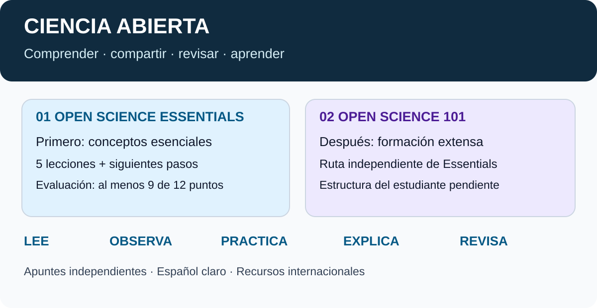

# Ciencia abierta · NASA en español

## Retoma tu estudio

**[📖 Abrir lección 4 · Componentes de la ciencia abierta](cursos/open-science-essentials/lecciones/04-componentes-ciencia-abierta.md)**

[🧪 Aplicar con el ejemplo sintético](ejemplos/leccion-04/README.md) · [📘 Índice del curso](cursos/open-science-essentials/README.md) · [🏷️ Glosario](GLOSARIO.md)

**Rama de estudio: `main`.** Lecciones 1–4 publicadas. Lección 5: pendiente de recibir el texto de Canvas; todavía no hay apuntes de esa lección.

**Aprende a compartir, revisar y reutilizar conocimiento científico.** Apuntes educativos independientes, en español claro, para estudiar desde GitHub en computador, teléfono o iPad.

[📘 Empezar el primer curso](cursos/open-science-essentials/README.md) · [▶ Leer la lección 1](cursos/open-science-essentials/lecciones/01-por-que-ciencia-abierta.md) · [🌍 Recursos gratuitos](RECURSOS.md) · [🧭 Cómo usar esto](COMO-ESTUDIAR.md)

> Este repositorio acompaña tu estudio. No es una publicación oficial de NASA ni reemplaza Canvas o sus evaluaciones. No necesitas instalar programas, pagar ni descargar el repositorio para leerlo.

## Estudia y aplícalo

Una ruta breve para convertir los apuntes en decisiones y productos. Los ejercicios siguen pendientes de tu revisión; no representan trabajo ya realizado ni aprobación de Canvas.

| Paso | Lo que estudias | Una aplicación concreta |
|---|---|---|
| 1 · Comprender | [Por qué ciencia abierta](cursos/open-science-essentials/lecciones/01-por-que-ciencia-abierta.md) | Escribe un beneficio y un límite para un ejemplo genérico |
| 2 · Decidir | [Preocupaciones y consideraciones](cursos/open-science-essentials/lecciones/02-preocupaciones-y-consideraciones.md) | Distingue qué puedes compartir y qué debes proteger |
| 3 · Planificar | [Planificación](cursos/open-science-essentials/lecciones/03-planificacion-ciencia-abierta.md) | Completa un [mini-OSDMP](cursos/open-science-essentials/anexos/03-mini-osdmp.md) con un responsable y un plazo |
| 4 · Preparar una entrega | [Componentes](cursos/open-science-essentials/lecciones/04-componentes-ciencia-abierta.md) | Revisa [datos, diccionario, código y resultados](ejemplos/leccion-04/README.md) del paquete sintético |
| 5 · Elegir herramientas | Tools for Open Science | Material del curso pendiente; se incorporará con el mismo formato |

**Desde iPad:** abre el repositorio, entra en `main` si estás viendo otra rama y usa el enlace **Abrir lección 4** al comienzo de este README. También puedes abrir directamente [la página de la lección](cursos/open-science-essentials/lecciones/04-componentes-ciencia-abierta.md). El notebook permite consultar salidas guardadas; GitHub no ejecuta sus celdas al leerlo.

## Elige qué necesitas ahora

| Quiero… | Pulsa aquí |
|---|---|
| Entender la idea en dos minutos | [Resumen visual de la lección 1](cursos/open-science-essentials/lecciones/01-por-que-ciencia-abierta.md#en-dos-minutos) |
| Estudiar el primer curso en orden | [Open Science Essentials](cursos/open-science-essentials/README.md) |
| Practicar antes del examen | [Preguntas con respuestas desplegables](cursos/open-science-essentials/lecciones/01-por-que-ciencia-abierta.md#comprueba-lo-que-entendiste) |
| Encontrar palabras en inglés | [Glosario español–inglés](GLOSARIO.md) |
| Aprender con texto, imágenes o lectura en voz alta | [Guía de estudio accesible](COMO-ESTUDIAR.md) |
| Ver datos, código y resultados juntos | [Ejemplo sintético y cuaderno](ejemplos/leccion-04/README.md) |
| Corregir algo o proponer un recurso | [Cómo contribuir](CONTRIBUTING.md) |

## Dos cursos, dos rutas

| Orden | Curso | Qué encontrarás aquí | Estado real del material |
|---|---|---|---|
| 1 | [Open Science Essentials](cursos/open-science-essentials/README.md) | Introducción opcional, cinco lecciones, siguientes pasos y evaluación final | Lecciones 1–4 disponibles; lección 5 pendiente |
| 2 | [Open Science 101](cursos/open-science-101/README.md) | Ruta separada para la formación extensa | Estructura de Canvas pendiente de aportar |

La [oferta oficial de NASA](https://science.nasa.gov/open-science/training/) distingue las dos formaciones. Preparar un apunte no significa haber completado una lección ni aprobado un examen.

**Última incorporación:** [Lección 4 · Componentes de la ciencia abierta](cursos/open-science-essentials/lecciones/04-componentes-ciencia-abierta.md), con tres diagramas y un [paquete sintético reproducible](ejemplos/leccion-04/README.md): CSV, diccionario, código, cuaderno y resultados.

**Profundización de la lección 2:** [Anexo legal: licencias y contribuciones](cursos/open-science-essentials/anexos/02-aspectos-legales-codigo-abierto.md) · [Políticas de publicación de código](cursos/open-science-essentials/lecciones/02-preocupaciones-y-consideraciones.md#8-financiación-pública-y-publicación-de-código).

## Así funciona cada lección

**Comprender → Ver → Aplicar → Recordar → Revisar.**

Cada lección publicada tendrá un nombre en español junto al original, resumen breve, imagen explicativa con alternativa textual, conceptos desarrollados, ejemplos, práctica, preguntas originales y recursos extra con idioma y formato.

¿Qué significa que el README sea interactivo?

Puedes pulsar enlaces, recorrer índices y desplegar explicaciones y respuestas. No hay un examen automático ni una app oculta. Las casillas y notas personales se guardan solo si editas un archivo en GitHub y confirmas el cambio; no se sincronizan con Canvas.

¿Estoy empezando con herramientas digitales?

Empieza con **Leer la lección 1**. Lee «En dos minutos», mira su imagen y abre solo una pregunta. Para volver, pulsa «Volver al curso». Los iconos siempre llevan palabras: no necesitas adivinar qué significan.

## Estudio abierto y responsable

- Contenido principal en español; términos ingleses para reconocerlos en Canvas.
- Recursos internacionales seleccionados por utilidad: español, inglés y chino.
- Datos de ejemplo genéricos o sintéticos; no se incorpora información de proyectos privados.
- Sin respuestas copiadas de evaluaciones oficiales ni certificados inventados.
- Texto, datos sintéticos e ilustraciones originales bajo [CC BY 4.0](LICENSE.md); código del ejemplo 4 bajo [MIT](ejemplos/leccion-04/LICENSE). Las fuentes externas conservan su licencia.
- Redacción asistida por IA con revisión documental; revisión del estudiante pendiente.

**Continuación:** las lecciones 1–4 ya tienen apuntes. La lección 5 se incorporará cuando compartas su contenido.

[Procedencia y verificación](VERIFICACION.md) · [Reglas editoriales](AGENTS.md) · [Plantilla para próximas lecciones](plantillas/LECCION.md)
