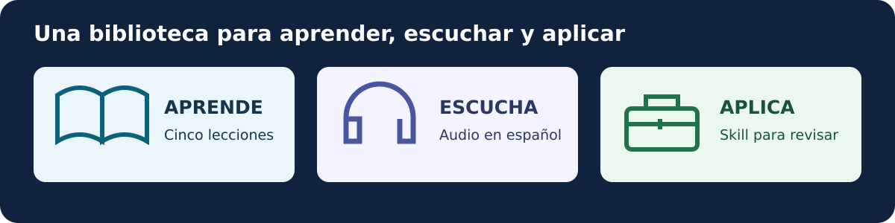
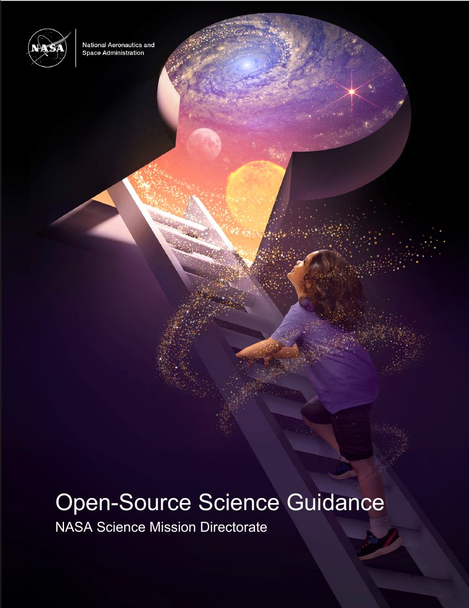
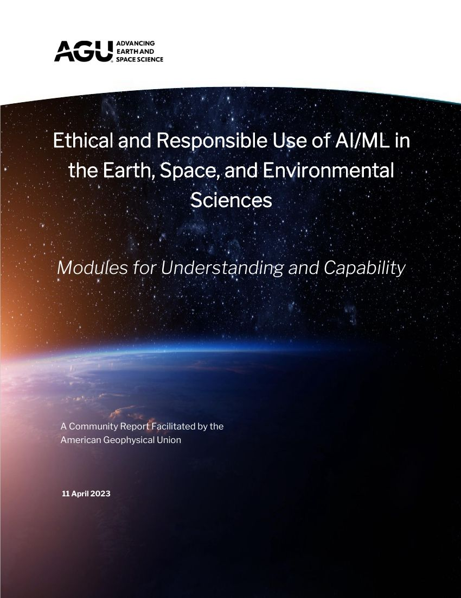
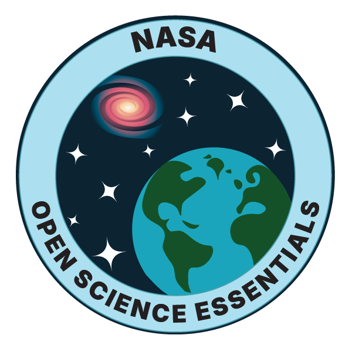

# 🌍 Biblioteca de ciencia abierta

**Aprende a compartir conocimiento científico y aplica lo aprendido a proyectos de software.** Una biblioteca educativa independiente, abierta a personas que empiezan, estudiantes, investigadoras y desarrolladores.

[🇪🇸 Español](README.md) · [🇬🇧 English summaries](idiomas/english.md) · [🇨🇳 中文导览](idiomas/chinese.md) · [🎧 Escuchar en español](audio/essentials/README.md)

> **Elige tu camino:** 📖 estudia los fundamentos · 🎧 escucha las lecciones · 🛠️ usa la skill para revisar un proyecto.

[📖 Empezar por la lección 1](cursos/open-science-essentials/lecciones/01-por-que-ciencia-abierta.md) · [🛠️ Conocer e instalar la skill](skills/revisar-ciencia-abierta/README.md) · [📚 Ver los documentos](#-biblioteca-de-documentos)

## 🧭 ¿Qué encontrarás aquí?

| Si quieres… | Empieza aquí | Qué puedes hacer |
|---|---|---|
| 📖 Aprender desde cero | [Fundamentos de ciencia abierta](cursos/open-science-essentials/README.md) | Recorrer cinco lecciones, ejemplos y preguntas |
| 🎧 Estudiar en movimiento | [Audios de las cinco lecciones](audio/essentials/README.md) | Escuchar o descargar lecturas en español |
| 🛠️ Aplicar lo aprendido | [Skill de revisión](skills/revisar-ciencia-abierta/README.md) | Pedir a un asistente que revise un proyecto |
| 📚 Profundizar | [Biblioteca de documentos](#-biblioteca-de-documentos) | Abrir los PDF y sus guías de estudio |
| 🧪 Practicar | [Ejemplo sintético](ejemplos/leccion-04/README.md) · [Cuaderno de trabajo](modulos/cuaderno-aplicacion.md) | Conectar datos, código y resultados |

No necesitas saber programar para comenzar. Cada pictograma tiene palabras y los materiales escritos se pueden navegar mediante enlaces.

## 📖 Ruta de aprendizaje · Empieza aquí

El primer libro de esta biblioteca aborda **Open Science Essentials: fundamentos de ciencia abierta**. Las páginas se pueden leer en orden o consultar por tema.

| Paso | Lección | Al terminar podrás… |
|---|---|---|
| 🌱 1 | [¿Por qué ciencia abierta?](cursos/open-science-essentials/lecciones/01-por-que-ciencia-abierta.md) | Explicar sus beneficios y la reproducibilidad |
| 🛡️ 2 | [Preocupaciones y consideraciones](cursos/open-science-essentials/lecciones/02-preocupaciones-y-consideraciones.md) | Reconocer barreras y decidir qué información proteger |
| 🗺️ 3 | [Planificación para la ciencia abierta](cursos/open-science-essentials/lecciones/03-planificacion-ciencia-abierta.md) | Comprender FAIR y preparar un plan de gestión |
| 🧩 4 | [Componentes de la ciencia abierta](cursos/open-science-essentials/lecciones/04-componentes-ciencia-abierta.md) | Relacionar datos, código, resultados y publicaciones |
| 🧰 5 | [Herramientas para la ciencia abierta](cursos/open-science-essentials/lecciones/05-herramientas-ciencia-abierta.md) | Elegir repositorios, licencias e identificadores |

Después puedes explorar [Próximos pasos](cursos/open-science-essentials/proximos-pasos.md) y las [preguntas de práctica](cursos/open-science-essentials/evaluacion.md). Las preguntas son educativas y no son el examen oficial.

### Así se estudia cada lección

**👀 Comprende → 🖼️ observa → ✍️ practica → 💬 explica → ✅ revisa.**

Cada lección reúne texto en español, ejemplos, pictogramas o diagramas con alternativa escrita, actividades y fuentes. Puedes avanzar a tu ritmo y volver a cualquier sección.

## 🛠️ Una herramienta para aplicar lo aprendido

### ¿Qué es la skill?

Una **skill** es una carpeta de instrucciones que ayuda a un asistente de inteligencia artificial a realizar una tarea. La skill de esta biblioteca guía una **revisión de ciencia abierta en proyectos de software científico**.

Busca evidencias sobre documentación, datos, código, licencias, versiones y reproducibilidad. Presenta lo observado, las propuestas y lo que falta comprobar. Es una ayuda para la revisión humana; no emite una certificación.

### Cómo comenzar

1. Abre la [guía de la skill](skills/revisar-ciencia-abierta/README.md).
2. Elige tu asistente: la guía describe rutas para **Codex, Claude Code, Gemini CLI y GitHub Copilot**.
3. Copia la carpeta completa de la skill y sus referencias siguiendo las instrucciones de tu herramienta.
4. En el proyecto que quieras revisar, pide:

> Usa la skill `revisar-ciencia-abierta` para revisar este proyecto en modo de solo lectura. Indica qué evidencias encontraste, qué podría mejorarse y qué no pudiste comprobar.

5. Revisa los resultados y decide qué cambios realizar.

La instalación y activación real **no se han probado en cada asistente**; consulta la documentación oficial enlazada en la guía. [Ver instrucciones de la skill](skills/revisar-ciencia-abierta/SKILL.md) · [Ver primera revisión de esta biblioteca](skills/revisar-ciencia-abierta/REVISION.md).

## 🎧 Escucha y accede a tu manera

- **Cinco lecciones en MP3:** [escuchar o descargar](audio/essentials/README.md). Son lecturas automáticas con voz sintética en español.
- **Otros documentos:** utiliza la lectura de pantalla disponible en tu dispositivo. La [guía de estudio](COMO-ESTUDIAR.md) explica cómo hacerlo en iPad.
- **Sin conexión:** descarga el audio antes de viajar; para leer otras páginas sin internet debes guardarlas en tu dispositivo.
- **Idiomas:** las lecciones completas están en español. Hay [resúmenes en inglés](idiomas/english.md) y [chino](idiomas/chinese.md); todavía no son traducciones completas.

## 📚 Biblioteca de documentos

Abre las portadas para consultar los PDF originales o elige sus guías de estudio en español. Para guardar un PDF, ábrelo y usa la opción de descarga de GitHub o de tu navegador.

| 🚀 Guía de ciencia abierta · NASA SMD | 🤖 Ética de IA y aprendizaje automático · AGU |
|---|---|
|  |  |
| **25 páginas · inglés · versión 2.2 de 2025** | **89 páginas · inglés · preprint de 2023** |
| [📄 Abrir o descargar PDF](assets/docs/SMD-Open-Source-Science-Guidance-v2.2-20250205.pdf) · [📖 Guía en español: 5 capítulos](modulos/guia-nasa-smd/README.md) | [📄 Abrir o descargar PDF](assets/docs/AGU-Etica-IA-ML-2023-v1.pdf) · [📖 Guía en español: 9 capítulos](modulos/etica-ia-agu/README.md) |

Las guías son adaptaciones educativas en español con conceptos, ejemplos y prácticas. [Consultar procedencia, versiones y derechos](assets/docs/README.md).

## 🏅 El aprendizaje que inspira esta biblioteca

La persona que impulsa este proyecto compartió la insignia obtenida en **Open Science Essentials** como parte del origen de la biblioteca. La imagen identifica ese logro; el proyecto y la skill son independientes y no se presentan como productos ni avales oficiales de NASA. No se incluye el certificado personal. La imagen por sí sola no sustituye un enlace de verificación de la credencial.

## 🌱 Un proyecto vivo

Hoy está disponible la ruta de **fundamentos** y sus materiales complementarios. La biblioteca seguirá creciendo con correcciones, recursos y nuevas rutas de estudio a medida que se preparen y revisen.

| Ruta | Estado |
|---|---|
| **Open Science Essentials** | Cinco lecciones disponibles; texto de introducción opcional pendiente |
| **Open Science 101** | Ruta separada reservada para material futuro; aún no desarrollada |

[Cómo contribuir](CONTRIBUTING.md) · [Recursos internacionales](RECURSOS.md) · [Glosario](GLOSARIO.md) · [Procedencia y verificación](VERIFICACION.md)

## ⚖️ Licencias y reconocimiento

El texto educativo y los diagramas originales se comparten bajo [CC BY 4.0](LICENSE.md); el código del ejemplo indicado utiliza [MIT](ejemplos/leccion-04/LICENSE). Los PDF, portadas, insignias y materiales de terceros conservan sus propias condiciones y atribuciones. Se utilizó asistencia de IA en la redacción, con revisión documental.

Las guías y la skill son recursos educativos independientes. No representan afiliación, revisión ni certificación del repositorio por NASA, MIT u otra institución.

---

Desarrollado por **Lattices Startup** · Una biblioteca abierta para aprender y compartir conocimiento.
