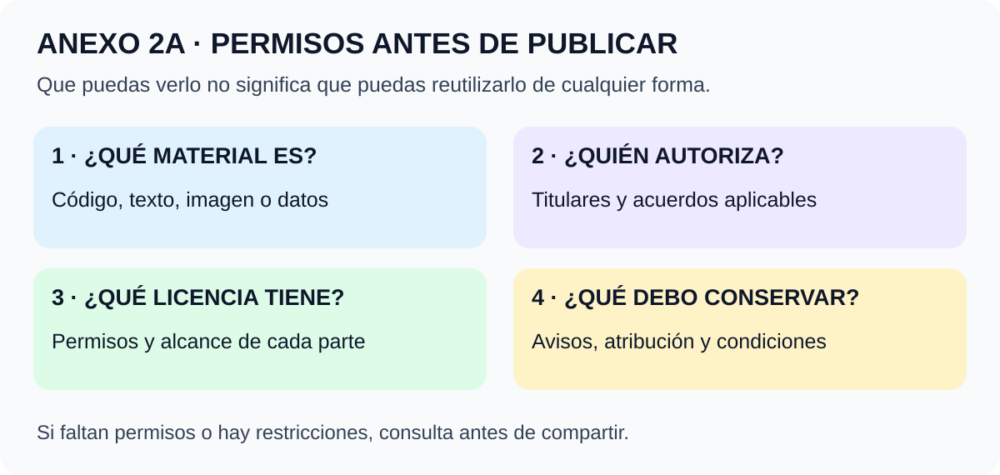

# Anexo 2A · Aspectos legales del código abierto

**Curso:** Open Science Essentials · **Complementa:** lección 2  
**Fuente de partida:** [The Legal Side of Open Source](https://opensource.guide/legal/) · [Versión en español](https://opensource.guide/es/legal/)  
**Revisión documental:** 27-10-2026 · Material educativo independiente

[← Volver a la lección 2](../lecciones/02-preocupaciones-y-consideraciones.md) · [📘 Curso](../README.md) · [🏠 Inicio](../../../README.md)

## En dos minutos

**Que puedas ver un archivo no significa que tengas permiso para reutilizarlo de cualquier manera.** Antes de compartir o incorporar un material, identifica su autoría, licencia, condiciones y alcance.

Este anexo es una síntesis y ampliación con fuentes primarias, no una traducción íntegra de la guía ni asesoría para resolver un caso jurídico concreto. La propia guía explica esa limitación en sus [avisos](https://opensource.guide/notices/).

**La imagen en palabras:** identificar el material → comprobar quién autoriza → leer su licencia → conservar avisos y documentar su uso. Si faltan permisos o existen restricciones, se consulta antes de publicar.

## 1. Qué propone la guía

La guía diferencia visibilidad y permisos. Recomienda licencias estándar, revisión de componentes ajenos y atención a las políticas de la organización. Examina cambios de licencia, contribuciones y cuestiones de empresa como titularidad, patentes y marcas.

Esta orientación se desarrolla abajo mediante fuentes específicas; los resúmenes no sustituyen los textos de las licencias. [Guía de GitHub](https://opensource.guide/legal/).

## 2. Público, gratuito y abierto son cosas diferentes

| Concepto | Lo que describe | Lo que no demuestra por sí solo |
|---|---|---|
| Público | Otras personas pueden verlo | Que todo uso esté autorizado |
| Gratuito | No se cobra por acceder o recibirlo | Que puedas modificarlo o redistribuirlo |
| Código visible | Puedes examinar su código | Que su licencia cumpla la definición de código abierto |
| Código abierto | Una licencia concede derechos compatibles con su definición | Que desaparezcan las condiciones de uso o distribución |

La [Open Source Definition de OSI](https://opensource.org/osd) incluye condiciones como redistribución, disponibilidad del código, obras derivadas y ausencia de discriminación por personas o campos de actividad. Por eso, una restricción general de uso comercial no encaja con esa definición.

**Sin licencia:** no asumas un permiso general para copiar, modificar o distribuir. Los términos de GitHub permiten ciertos usos dentro de su servicio; además, pueden existir excepciones legales según jurisdicción. Ninguna de esas cosas equivale a una licencia abierta general. [Choose a License: No License](https://choosealicense.com/no-permission/) · [Términos de GitHub](https://docs.github.com/en/site-policy/github-terms/github-terms-of-service).

**Ejemplo didáctico:** encontrar un programa en un repositorio público no basta para incorporarlo a otro proyecto. Primero localiza su licencia y la de las partes que vas a reutilizar.

## 3. Comparación inicial de licencias de software

La tabla sirve para reconocer diferencias; no es una matriz completa de compatibilidad ni una recomendación universal.

| Licencia | Familia | Qué conviene reconocer |
|---|---|---|
| MIT | Permisiva | Autoriza usos amplios, incluidos modificación, distribución y uso comercial; requiere conservar los avisos indicados |
| Apache-2.0 | Permisiva | Contiene una concesión expresa de patentes de los contribuyentes y condiciones de redistribución |
| GPL-3.0 | Copyleft fuerte | La distribución de obras cubiertas puede exigir conservar la licencia y proporcionar el código correspondiente |

### MIT: permiso amplio con condiciones

Conservar el aviso de copyright y la licencia es una condición importante. La licencia también incluye exclusiones de garantía y responsabilidad. «Permisiva» no significa «sin condiciones», y no elimina los derechos de terceros que no pueda conceder el titular. [Texto MIT y resumen](https://choosealicense.com/licenses/mit/).

### Apache-2.0: copyright y patentes no son lo mismo

La licencia contiene una concesión de derechos de autor y una concesión de patentes con alcance y condiciones definidos. En redistribuciones hay que revisar su sección 4: licencia, avisos aplicables, identificación de archivos modificados y tratamiento del archivo NOTICE cuando corresponda.

Su sección 6 no concede una autorización general sobre marcas. No significa que estén cubiertas todas las patentes del mundo ni que puedas usar un logo para insinuar respaldo. [Texto Apache-2.0, secciones 2–6](https://www.apache.org/licenses/LICENSE-2.0).

### GPL-3.0: importa qué haces con la obra

No la resumas como «si la uso, todo se vuelve público». Hay que examinar la obra cubierta, las modificaciones y la forma de distribución. Cuando se distribuye una obra cubierta, sus condiciones pueden exigir acceso al código correspondiente y mantener la misma licencia.

El uso comercial está permitido por GPL; copyleft no significa «prohibido vender». [Resumen y texto GPL-3.0](https://choosealicense.com/licenses/gpl-3.0/).

Para licencias de red como AGPL o casos de copyleft limitado como MPL y LGPL, revisa el texto específico y cómo se integra el componente. No extrapoles las reglas de otra licencia.

## 4. Texto, imágenes, datos y código pueden tener licencias distintas

**Ampliación con fuentes de licenciamiento.** Un repositorio puede reunir documentación, fotos, datos y programas. Es necesario indicar qué licencia corresponde a cada parte. Creative Commons no recomienda sus licencias para software; documentación y materiales no informáticos tienen otras opciones. [Licencias para material no informático](https://choosealicense.com/non-software/).

En este repositorio, [LICENSE.md](../../../LICENSE.md) declara **CC BY 4.0 para el texto y las ilustraciones originales**. Esa declaración no cambia las licencias de los artículos o recursos externos enlazados.

Con CC BY 4.0 se permite compartir y adaptar, incluso comercialmente, con atribución, enlace a la licencia e indicación de cambios. La licencia no implica respaldo del autor y no resuelve por sí sola derechos de privacidad, imagen o marcas. [Resumen oficial en español](https://creativecommons.org/licenses/by/4.0/deed.es).

### Ejemplo de atribución didáctica

> Adaptado de «Ciencia abierta · apuntes educativos independientes», Delnr91 y colaboradores, enlace al repositorio, CC BY 4.0. Cambios: simplificación del ejemplo y traducción de términos.

Es un ejemplo: incluye los datos reales de la obra que utilices, no atribuciones inventadas.

## 5. Cómo revisar materiales y dependencias

**Actividad de organización propuesta:** prepara un inventario antes de integrar archivos ajenos. No declara compatibilidad ni cumplimiento por sí mismo.

| Material | Procedencia y versión | Licencia o permiso localizado | Qué falta comprobar |
|---|---|---|---|
| Biblioteca de cálculo | Repositorio y versión exactos | Identificador y texto de licencia | Condiciones de integración y redistribución |
| Imagen educativa | Página del autor | Licencia específica de la imagen | Atribución, modificaciones y otros derechos |
| Conjunto de datos | Registro de publicación | Términos de acceso y reutilización | Restricciones y tratamiento de información sensible |

No se aplica automáticamente la licencia principal de un repositorio a todo lo que enlaza o incorpora. Conserva los avisos que correspondan y registra las decisiones. En un proyecto mixto conviene que cada parte tenga un alcance explícito. [Orientación sobre proyectos mixtos](https://choosealicense.com/non-software/) · [Condiciones concretas Apache](https://www.apache.org/licenses/LICENSE-2.0).

**Pregunta útil:** ¿tengo permiso para publicar este componente y puedo cumplir sus condiciones dentro de esta entrega? Si no está claro, consulta antes de incluirlo.

## 6. Contribuciones: licencia, CLA y DCO

### Contribuir no equivale a entregar todos tus derechos

Los términos de GitHub contemplan la contribución a un repositorio con licencia y los acuerdos separados que puedan existir. Lee las condiciones del proyecto antes de enviar un cambio; no supongas que una plataforma decide quién es titular de todo el trabajo. [GitHub, sección sobre contribuciones bajo licencia](https://docs.github.com/en/site-policy/github-terms/github-terms-of-service).

### CLA: acuerdo específico

Un **Contributor License Agreement** es un acuerdo adicional cuyas cláusulas deben leerse. Puede tratar autorizaciones, patentes o posibilidades de relicenciamiento. Su nombre no permite deducir que siempre transfiere la titularidad. La guía indica que en muchos proyectos no hace falta imponer un acuerdo adicional. [Apartado de acuerdos de contribución](https://opensource.guide/legal/#does-my-project-need-an-additional-contributor-agreement).

### DCO: certificación del origen del aporte

El **Developer Certificate of Origin 1.1** permite declarar, en los términos de su texto, que se tiene una vía legítima para aportar el trabajo y que se entiende el carácter público del registro de contribución.

No reemplaza la licencia de salida del proyecto ni demuestra por sí solo que no pueda existir una disputa. Un registro de firma no es una revisión jurídica. [Texto oficial DCO](https://developercertificate.org/).

**En este repositorio:** este anexo no instala un bot, impone firmas ni crea un CLA nuevo. Describe herramientas para comprender la participación.

## 7. Cambiar una licencia requiere revisar el historial

**Síntesis de la guía.** Una nueva licencia puede afectar a contribuyentes y usuarios. Antes de cambiarla se necesita identificar quién puede autorizarlo y qué condiciones de componentes existentes deben conservarse. Una licencia nueva para futuras aportaciones no equivale automáticamente a relicenciar el trabajo anterior. [Cambio de licencia](https://opensource.guide/legal/#what-if-i-want-to-change-the-license-of-my-project).

**Ejercicio de razonamiento:** un archivo tiene aportes de varias personas y un componente externo. ¿Qué información falta antes de cambiar su licencia? Anota titulares, autorizaciones, condiciones originales y alcance de la nueva versión. No basta con reemplazar el nombre del archivo LICENSE.

La compatibilidad debe evaluarse en una dirección y situación concretas. Conservar condiciones previas no es lo mismo que borrar su origen. Para una obra GPL distribuida, consulta sus reglas de distribución y código correspondiente. [GPL-3.0](https://choosealicense.com/licenses/gpl-3.0/).

## 8. Organización, marcas y publicación científica

Una autorización para usar software no concede necesariamente autorización para publicar datos asociados o utilizar marcas. Apache-2.0 lo ilustra al separar derechos de autor, patentes y marcas. [Texto de la licencia](https://www.apache.org/licenses/LICENSE-2.0).

**Conexión con la lección 2:** las decisiones de licenciamiento deben convivir con los permisos de publicación y la protección de datos. Un dato sensible no se vuelve publicable por añadir una licencia.

Si el material procede de un empleo, contrato o subvención, comprueba quién autoriza y qué condiciones acordadas existen. Para los ejemplos de agencias del curso consulta [Financiación pública y publicación de código](../lecciones/02-preocupaciones-y-consideraciones.md#8-financiación-pública-y-publicación-de-código).

## 9. Prueba tú: un paquete educativo ficticio

Un equipo quiere compartir:

- Su explicación escrita original.
- Un programa que incorpora una biblioteca MIT.
- Una fotografía descargada sin licencia identificada.
- Datos que permiten identificar participantes.

Decide qué revisar antes de publicar. No basta con elegir una licencia para la carpeta completa.

Ver una respuesta razonada

Hay que separar las partes. El texto requiere autorización de sus titulares. La biblioteca exige revisar su licencia y conservar los avisos aplicables. La fotografía necesita permiso o una alternativa con condiciones conocidas. Los datos personales requieren una decisión independiente sobre permisos y riesgos; no se publican solo porque el texto tenga licencia abierta.

No se afirma que todo pueda publicarse al final de esta actividad.

## 10. Repaso rápido

¿Un repositorio público sin licencia es automáticamente código abierto?

No. Visibilidad y licencia son conceptos distintos. Revisa permisos expresos y condiciones antes de reutilizar.

¿Copyleft impide cobrar por software?

No. GPL permite uso comercial, con las condiciones que correspondan.

¿CC BY 4.0 del repositorio autoriza copiar cualquier fotografía enlazada?

No. Su alcance cubre el material declarado; cada recurso externo conserva sus derechos.

¿Un DCO reemplaza una licencia?

No. Trata el origen y la legitimidad del aporte en sus términos; no sustituye los permisos de reutilización de salida.

## Fuentes, atribución y alcance

**Contenido basado parcialmente en Open Source Guides, autores de la guía**, utilizado bajo [CC BY 4.0](https://creativecommons.org/licenses/by/4.0/). Fuente: [guía inglesa](https://opensource.guide/legal/) y [guía española](https://opensource.guide/es/legal/). Cambios: síntesis educativa en español, organización para la lección 2, ejemplos, ejercicios e imagen originales y contraste con textos de licencias. No se copiaron ilustraciones o marcas de GitHub.

Fuentes complementarias: OSI, textos y fichas MIT/Apache/GPL, Creative Commons, términos de GitHub y DCO enlazados en cada apartado. La revisión no constituye auditoría legal de un proyecto real ni demuestra compatibilidad de una combinación concreta.

[← Lección 2](../lecciones/02-preocupaciones-y-consideraciones.md) · [📘 Curso](../README.md)
