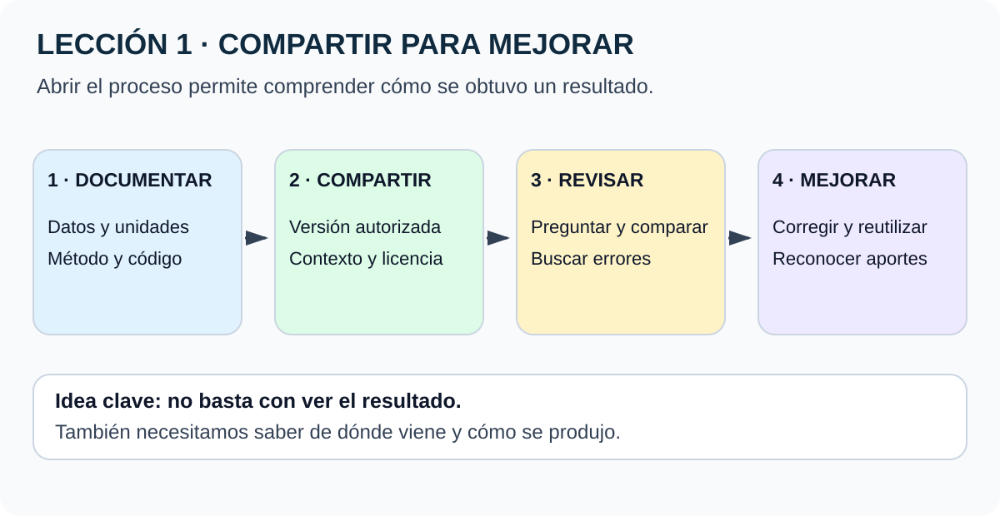
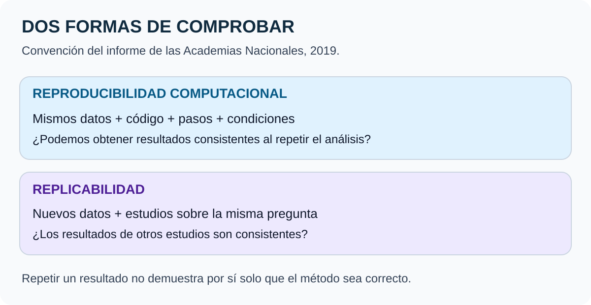

# Lección 1 · ¿Por qué hacer ciencia abierta?

**Original:** Lesson 1 – Why Open Science?  
**Curso:** Open Science Essentials · **Material:** disponible · **Comprensión:** pendiente de comprobar

[🏠 Inicio](../../../README.md) · [📘 Volver al curso](../README.md) · [Siguiente: lección 2 →](02-preocupaciones-y-consideraciones.md)

## En dos minutos

La ciencia abierta es una cultura de colaboración. La tecnología ayuda a compartir datos, información y conocimientos con científicos y con el público para avanzar en investigación y comprensión.

**Abrir permite que otras personas comprendan, revisen, reutilicen y mejoren el trabajo.** No garantiza que todo sea correcto ni exige publicar información que deba protegerse.

**La imagen en palabras:** documentar → compartir de forma autorizada → revisar → corregir y reutilizar. Las mejoras vuelven al proceso y reconocen a quienes contribuyeron.

## Qué podrás explicar

Al terminar deberías poder:

- Explicar qué se comparte, quién participa y para qué.
- Distinguir reproducibilidad de replicabilidad con un ejemplo.
- Describir un beneficio de la apertura y una condición para conseguirlo.
- Interpretar las cifras del curso sin confundir asociación con causalidad.

## 1. Qué significa ciencia abierta

**Síntesis del curso.** La definición citada en la lección reúne cinco elementos: cultura colaborativa, tecnología, intercambio abierto, participación científica y pública, y aceleración de la investigación y la comprensión.

No se limita a publicar un PDF. Incluye materiales y decisiones que permiten entender cómo se llegó a un resultado. Un archivo visible pero sin unidades, método o instrucciones puede ser difícil de reutilizar.

**Ejemplo didáctico:** un equipo publica una gráfica de temperaturas. Para examinarla hacen falta los datos, sus unidades, las fechas, el programa y los pasos de cálculo. Compartir esos elementos permite comprobar el recorrido.

## 2. Beneficios y sus límites

| Práctica | Qué puede facilitar | Qué necesita |
|---|---|---|
| Publicar datos documentados | Nuevos análisis y colaboraciones | Procedencia, unidades y condiciones de uso |
| Compartir código | Revisar y repetir el procedimiento | Dependencias, versiones y parámetros |
| Facilitar acceso al artículo | Mayor alcance y lectura | Un canal compatible con los derechos de publicación |
| Recibir comentarios | Detectar problemas antes | Comunicación respetuosa y respuesta a errores |
| Conservar materiales | Acceso a largo plazo | Un plan real de preservación y mantenimiento |
| Reconocer aportes | Colaboración más justa | Citar también datos, código y trabajo técnico |

El curso relaciona estas prácticas con mejor calidad, visibilidad y propuestas de financiación. Son beneficios posibles: abrir un repositorio no asegura una subvención ni valida automáticamente sus resultados.

### Las cifras de citas

- **18 %:** el curso cita a Piwowar et al. (2018) sobre una ventaja de citas asociada al acceso abierto.
- **Hasta aproximadamente 25 %:** Colavizza et al. (2020) encontraron una asociación entre enlazar datos en repositorios y mayor impacto de citas, en su modelo y conjunto de artículos.

**Para el repaso:** son cifras de estudios concretos. No prometen un aumento para cada artículo ni prueban que compartir sea la única causa. Tampoco deben sumarse como «43 % garantizado». [Piwowar](https://doi.org/10.7717/peerj.4375) · [Colavizza](https://journals.plos.org/plosone/article?id=10.1371/journal.pone.0230416).

El acceso abierto no obliga siempre a pagar. El curso anticipa preprints y acceso abierto diamante. **Ampliación conceptual:** un preprint debe identificarse como manuscrito anterior a revisión por pares; el modelo diamante no cobra a autores por publicar ni a lectores por leer. Deben revisarse las condiciones de cada revista o repositorio.

## 3. Reproducibilidad y replicabilidad

**Ampliación verificada:** seguimos la convención de las Academias Nacionales (2019). Otros campos pueden utilizar los términos de otra manera.

| Concepto | Pregunta que responde | Ejemplo genérico |
|---|---|---|
| Reproducibilidad computacional | ¿Se obtienen resultados consistentes con los mismos datos, pasos, código y condiciones? | Otra persona vuelve a ejecutar el análisis original |
| Replicabilidad | ¿La misma pregunta recibe resultados consistentes en otro estudio con datos nuevos? | Un equipo recoge otra serie de observaciones y contrasta la conclusión |

La imagen representa esas dos situaciones; no son dos grados de calidad. Ambas ayudan a revisar el conocimiento.

**Importante:** repetir correctamente un programa no demuestra que su hipótesis sea válida. Un error de método también puede reproducirse. [Informe de las Academias Nacionales](https://www.nationalacademies.org/read/25303/chapter/2).

### La crisis de reproducibilidad

El fragmento del curso resume una encuesta de Baker (2016) a **1.576 investigadores**:

- Cerca del **70 %** declaró intentos fallidos de reproducir experimentos ajenos.
- Cerca del **50 %** declaró dificultades con sus propios experimentos.
- Más del **60 %** señaló problemas como informes selectivos y presión por publicar.

También menciona poca replicación, supervisión deficiente y baja potencia estadística.

**No significa que el 70 % de toda la ciencia sea falsa.** Son experiencias declaradas por encuestados, no una auditoría universal de artículos. Aquí las cifras se conservan como contenido del curso: la [página de Nature](https://doi.org/10.1038/533452a) permite identificar el artículo, pero su texto completo no se verificó en esta revisión.

## 4. Compartir también permite corregir

### Un error en MATLAB

Según el caso aportado en el curso, los autores de un estudio de *Acta Psychologica* publicaron sus archivos de análisis. Un colega encontró un error. El código corregido ya no sostenía las conclusiones originales y los autores solicitaron retractar el artículo.

**Qué enseña:** abrir materiales permite detectar errores y corregir el registro científico. Una retractación debe interpretarse según su causa; no equivale automáticamente a fraude. [Dolk et al., 2019](https://doi.org/10.1016/j.actpsy.2019.102886), referencia del curso; texto completo pendiente de contraste.

### La fusión fría

El curso presenta el caso de Pons y Fleischmann: el anuncio generó expectativas, pero la información y las comprobaciones posteriores no sostuvieron de forma convincente el resultado anunciado.

**Qué enseña:** la urgencia por publicar no sustituye el detalle metodológico ni el contraste independiente. No repetimos aquí como dato verificado la estimación económica del texto original. [Caso de Understanding Science, Berkeley](https://undsci.berkeley.edu/cold-fusion-a-case-study-for-scientific-behavior/), lectura citada por el curso.

## 5. Ejemplos del espacio

### Event Horizon Telescope

El curso destaca que la imagen de un agujero negro se apoyó en herramientas y bibliotecas abiertas. La enseñanza es reconocer también a quienes desarrollaron y mantuvieron las piezas de software reutilizadas.

La cifra de contribuyentes del ecosistema de dependencias no debe confundirse con el número de integrantes directos del telescopio. No se incorpora una cifra sin verificar su alcance.

### James Webb y los datos tempranos

El programa de ciencia temprana de Webb muestra cómo datos disponibles, herramientas abiertas y colaboración pueden acelerar análisis. NASA/JPL describe la detección de CO₂ en la atmósfera de **WASP-39 b**, un gigante gaseoso caliente.

**Detectar CO₂ no demuestra vida.** El hallazgo aporta información sobre composición y formación planetaria. Tampoco implica que todos los datos de Webb tengan las mismas condiciones de acceso. [NASA/JPL](https://www.jpl.nasa.gov/news/nasas-webb-detects-carbon-dioxide-in-exoplanet-atmosphere/).

## 6. Reconocer el trabajo colectivo

Mantener una biblioteca, limpiar datos, escribir documentación y revisar código contribuyen a la ciencia aunque no produzcan un anuncio espectacular.

El curso cuestiona los incentivos concentrados en novedades e individuos. Una práctica útil es declarar las contribuciones y citar los productos reutilizados.

**Corrección de traducción:** *overlooking the community* quiere decir **pasar por alto a la comunidad**. Traducirlo como «reconocer a la comunidad» invierte el argumento.

## Prueba tú · Actividad 1.1

Piensa en un proyecto anterior que puedas describir públicamente. Si no tienes uno, utiliza este **ejemplo ficticio**:

> Un grupo compara temperaturas medidas en dos lugares. Solo comparte el gráfico final.

Escribe cuatro frases:

1. Qué materiales compartirías para ayudar a comprender el gráfico.
2. Cómo eso facilitaría revisar un error.
3. Qué información necesitaría protección.
4. Cómo comprobarías que otra persona pudo repetir el análisis.

Ver una respuesta modelo

Compartiría una tabla de datos autorizada, unidades, código e instrucciones. Otra persona podría revisar filtros y detectar un cálculo incorrecto. No publicaría datos personales ni ubicaciones que deban protegerse. Le pediría ejecutar el ejemplo y comparar la salida con un criterio previamente definido.

Es una propuesta didáctica, no una actividad que el estudiante ya haya realizado.

## Comprueba lo que entendiste

Estas preguntas son originales; no provienen del examen de NASA.

1. ¿Qué hace «abierta» a la ciencia, además de permitir leer un artículo?

Compartir de forma responsable materiales, métodos y conocimiento, y facilitar colaboración, revisión y reutilización.

2. ¿Más citas demuestran automáticamente mayor calidad?

No. Las citas son una medida de uso o atención; hay que examinar la calidad de métodos y evidencia.

3. ¿Puedo sumar 18 % y 25 % para prometer una ventaja del 43 %?

No. Proceden de estudios y comparaciones distintos, con asociaciones que no se combinan así.

4. ¿Ejecutar el mismo código con los datos originales es replicabilidad?

En la convención utilizada es reproducibilidad computacional. Replicabilidad implica estudios con nuevos datos.

5. ¿Un resultado reproducible necesariamente es correcto?

No. Un error puede repetirse consistentemente. También se necesita revisar el diseño, los supuestos y la interpretación.

6. ¿Qué permitió descubrir el error en MATLAB?

Que los archivos se compartieran y otra persona pudiera revisar el análisis. La apertura facilitó la corrección.

7. ¿La encuesta demuestra que el 70 % de los artículos es falso?

No. Resume respuestas de investigadores sobre experiencias de reproducción, no una proporción universal de artículos inválidos.

8. ¿Por qué aparece CO₂ en esta lección?

Como ejemplo de un hallazgo apoyado por colaboración y datos tempranos; no como prueba de vida extraterrestre.

## Para escuchar o leer en voz alta

La ciencia abierta es una forma de colaborar. Compartimos datos, métodos y herramientas para que otras personas puedan comprender, revisar y continuar una investigación. Eso puede ayudar a detectar errores y ampliar el impacto. Reproducir es repetir un análisis con sus materiales originales; replicar utiliza datos nuevos para contrastar una pregunta. Abrir responsablemente también exige proteger información y reconocer contribuciones.

## Fuentes y límites

**Procedencia:** texto bilingüe de la lección compartido por el estudiante el 26-10-2026. Síntesis independiente, no transcripción ni traducción oficial.

**Contrastado:** oferta de cursos NASA, definiciones NASEM, artículo de Colavizza y explicación NASA/JPL. **Contraste parcial:** resumen indexado de Piwowar; texto completo no disponible en la comprobación. **Aportado por el curso, pendiente de contraste completo:** encuesta de Baker y detalles de los casos de MATLAB, fusión fría y EHT.

La lección atribuye la definición a [Ramachandran, Bugbee y Murphy](https://doi.org/10.1029/2020EA001562). El texto recibido mezcla 2020 y 2021 en su referencia; no se interpreta el año del identificador del manuscrito como fecha de publicación verificada.

Lectura adicional del curso: [McKiernan et al., 2016](https://doi.org/10.7554/eLife.16800). Para otras opciones e idiomas, consulta [Recursos](../../../RECURSOS.md) y el [glosario](../../../GLOSARIO.md).

[← Curso](../README.md) · [Lección 2 →](02-preocupaciones-y-consideraciones.md)
