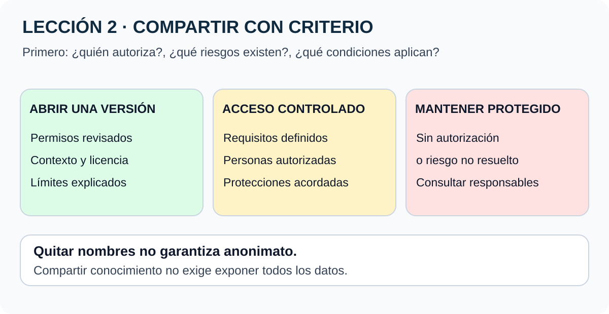

# Lección 2 · Preocupaciones y consideraciones al practicar ciencia abierta

**Original:** Lesson 2 – Concerns and Considerations When Practicing Open Science  
**Curso:** Open Science Essentials · **Material:** disponible · **Comprensión:** pendiente de comprobar

[🏠 Inicio](../../../README.md) · [📘 Curso](../README.md) · [← Lección 1](01-por-que-ciencia-abierta.md)

## En dos minutos

Compartir puede generar dudas: que encuentren errores, no reconozcan tu trabajo o se publiquen datos que debían protegerse. La respuesta es planificar cómo compartir, documentar límites y buscar apoyo.

**Ciencia abierta no significa publicarlo todo.** Hay materiales abiertos, materiales con acceso controlado y materiales que no deben difundirse. La decisión depende de derechos, consentimiento, políticas, riesgos y obligaciones aplicables.

**La imagen en palabras:** antes de compartir, comprueba si tienes autorización y qué riesgos existen. Puede ser adecuado abrir una versión, limitar el acceso o no publicarla. El diagrama es una ayuda conceptual; no sustituye una revisión especializada.

## Qué podrás explicar

- Relacionar una preocupación con una medida concreta para abordarla.
- Diferenciar barreras sociales, institucionales e infraestructurales.
- Explicar por qué quitar nombres no garantiza anonimato.
- Proponer una forma de compartir conocimiento sin exponer información sensible.

## 1. Ocho preocupaciones frecuentes

**Síntesis del curso.** Las dudas son reales; reconocerlas ayuda a elegir prácticas sostenibles.

| Preocupación | En palabras sencillas | Respuesta posible |
|---|---|---|
| Mistakes | ¿Y si encuentran un error? | Compartir con contexto y corregir de forma trazable |
| Scooping | ¿Y si alguien se adelanta usando mi trabajo? | Depositar versiones fechadas y facilitar su cita |
| Misinterpretation | ¿Y si lo interpretan mal? | Documentar qué hace, qué no hace y cómo usarlo |
| Citation | ¿Y si no me citan? | Añadir autoría e instrucciones claras de citación |
| Update | ¿Tendré que mantenerlo para siempre? | Declarar el estado y archivar una versión documentada |
| Sensitive | ¿Y si los datos son sensibles? | Evaluar permisos, riesgos y acceso controlado |
| Useful | ¿Y si nadie lo utiliza o el resultado es negativo? | Describir el método y el alcance de lo que se aprendió |
| Barriers | ¿Y si no tengo apoyo o infraestructura? | Identificar necesidades y buscar soluciones viables |

### Errores

Abrir un trabajo puede dar miedo. Sin embargo, una revisión respetuosa permite encontrar problemas antes de que otras personas dependan de ellos. Compartir no significa renunciar a revisar el material antes de publicarlo.

**Acción práctica:** describe el estado de tu trabajo y conserva un registro de correcciones. Una versión preliminar no debe presentarse como conclusión validada.

### Adelantarse a publicar: scooping

La traducción «extracción» no explica el concepto. *Scooping* alude a que otro equipo se adelante en publicar un resultado o una idea sobre la que trabajabas. Puede relacionarse con apropiación, pero **no es sinónimo automático de plagio**.

Un depósito fechado y citable ayuda a documentar una versión y facilitar su reconocimiento. **No garantiza que nadie se adelante ni demuestra por sí solo propiedad o prioridad jurídica.**

### Malinterpretación y citación

Una documentación útil explica entradas, métodos, límites y ejemplos. Para facilitar la cita, identifica autores, título, versión y enlace persistente cuando exista.

Un DOI identifica un objeto de investigación de manera persistente: **no es un certificado de calidad ni una garantía de atribución**. También debes citar el trabajo de otras personas.

### Mantenimiento y utilidad

Abrir materiales no supone mantenerlos durante toda la vida. Puedes dejar una versión archivada, explicar que no tendrá soporte y definir cómo proponer cambios.

Los resultados negativos también informan: ayudan a evitar repetir intentos y a revisar hipótesis. No encontrar un efecto **no prueba siempre que no exista**; importan el diseño, los datos y la potencia del estudio.

## 2. Barreras sociales, institucionales e infraestructurales

| Tipo | Ejemplo | Una mejora razonable |
|---|---|---|
| Social | Desacuerdos o temor a preguntar | Escucha activa, acuerdos y lenguaje respetuoso |
| Institucional | No se reconoce el tiempo dedicado a documentar | Acordar tareas, responsabilidades y apoyo con supervisión |
| Infraestructural | La herramienta exige cuentas a las que otros no acceden | Buscar una alternativa autorizada y accesible |

El curso recomienda empatía, humildad, preguntas que busquen entender el contexto y colaboración antes del conflicto. Las reglas de participación y los códigos de conducta orientan el trato; las licencias regulan usos de los materiales. **No cumplen la misma función.**

No todos los cambios dependen de una persona. Trabajar de forma gradual dentro de los permisos y recursos existentes puede ser más sostenible que prometer apertura completa sin apoyo.

**Corrección de sentido:** superar barreras de infraestructura significa buscar acuerdos y herramientas permitidas, no eludir controles de acceso de una institución.

## 3. Diseñar para que más personas participen

**Ejemplo didáctico añadido:** un equipo internacional intenta reunirse siempre a la misma hora. Para algunas personas eso significa trabajar de madrugada. Una solución es alternar horarios y permitir aportes por escrito.

Otras prácticas:

- Explicar siglas antes de usarlas.
- Ofrecer notas breves además de reuniones.
- Elegir formatos que no exijan equipos potentes.
- Acompañar imágenes con una explicación escrita.
- Separar lo imprescindible de la ampliación opcional.
- Acordar canales y tiempos de respuesta.

Usar una herramienta conocida no garantiza inclusión: hay que comprobar acceso, idioma, coste, permisos y necesidades del grupo.

## 4. Qué compartir y qué proteger

La decisión debe tomarse **antes** de publicar.

| Situación didáctica | Alternativa que podría evaluarse |
|---|---|
| Un método general sin restricciones identificadas | Publicarlo con documentación y licencia autorizada |
| Datos que podrían identificar a participantes | Evaluar consentimiento, minimización y revisión de riesgo |
| Datos que requieren acuerdos específicos | Acceso controlado según los responsables autorizados |
| Material sin permiso de publicación | Mantenerlo protegido; quizá compartir una descripción permitida |
| Un ejemplo que no necesita datos reales | Usar datos sintéticos bien identificados como tales |

No se puede decidir la legalidad de un caso real solo con esta tabla.

### Anonimización y riesgo de identificación

**Ampliación documentada:** eliminar el nombre no basta necesariamente. La combinación de fechas, ubicaciones y atributos poco frecuentes puede identificar a una persona. Tampoco un código que reemplaza el nombre garantiza anonimato si existe una clave o posibilidad de vinculación.

La guía de [HHS sobre desidentificación](https://www.hhs.gov/hipaa/for-professionals/special-topics/de-identification/index.html) trata métodos y evaluación de riesgo en el contexto de HIPAA. No es una receta universal que autorice publicar cualquier conjunto de datos.

## 5. Referencias normativas del curso: leer con contexto

La lección menciona ejemplos estadounidenses: ITAR, EAR, HIPAA, información controlada no clasificada y normas de protección de sistemas espaciales.

| Referencia | Contexto educativo | Fuente de consulta |
|---|---|---|
| ITAR | Control estadounidense de ciertos artículos, servicios y datos técnicos de defensa | [DDTC](https://www.pmddtc.state.gov/ddtc_public) |
| EAR | Regulaciones estadounidenses de administración de exportaciones | [BIS: índice EAR](https://www.bis.gov/regulations/ear/table-of-contents) |
| HIPAA | Marco estadounidense con reglas sobre información de salud y sujetos cubiertos | [Guía HHS](https://www.hhs.gov/hipaa/for-professionals/special-topics/de-identification/index.html) |
| NASA-STD-1006 | Estándar NASA de protección de sistemas espaciales | [Catálogo oficial](https://standards.nasa.gov/standard/NASA/NASA-STD-1006) |

**Corrección de referencia:** el fragmento dice «NASA STD 1006.1». El catálogo consultado identifica **NASA-STD-1006, revisión A**, con estado activo. Se registra la diferencia para consultar la referencia correcta, no se da por equivalente cualquier documento.

Estas referencias no se convierten automáticamente en obligaciones para cualquier estudiante, país o proyecto. La aplicabilidad requiere examinar el caso y consultar los responsables competentes. No se ofrece asesoría jurídica ni se afirma cumplimiento.

Las citas de políticas del Departamento de Comercio o USGS y el porcentaje histórico de código abierto incluido en el fragmento **no se reproducen como políticas vigentes verificadas**: faltan sus enlaces originales y su contexto temporal.

## 6. El estudio de los gemelos: valor científico y privacidad

NASA estudió a Scott Kelly durante su estancia espacial y a Mark Kelly en la Tierra para investigar efectos del vuelo espacial. La comparación ayuda a formular y explorar preguntas, pero **dos participantes no permiten generalizar automáticamente a toda la población**.

El caso muestra por qué los datos biomédicos pueden tener alto valor científico y necesitar protección especial. Publicar resultados no significa que todos los registros individuales estén disponibles sin condiciones.

Se evita la promesa de la traducción de que los datos «garantizan» la seguridad de futuros viajeros: aportan conocimiento para evaluar riesgos, no una garantía universal. [NASA: Twins Study](https://www.nasa.gov/humans-in-space/twins-study/) · [Resultados publicados](https://www.nasa.gov/humans-in-space/nasas-twins-study-results-published-in-science-journal/).

El fragmento también cita **OSD-530**, un estudio de JAXA sobre seis astronautas: no debe confundirse con el estudio de los gemelos. Su referencia se conserva para revisión: [DOI 10.26030/r2xr-h714](https://doi.org/10.26030/r2xr-h714). El conjunto no se descargó ni se comprobaron sus condiciones de acceso.

## 7. Antes de compartir un producto de investigación

Preguntas para pensar, no una certificación automática:

1. ¿Quién puede autorizar la publicación?
2. ¿Qué establecen la institución y la convocatoria de financiación?
3. ¿Tengo permiso para compartir las partes de otras personas?
4. ¿Hay datos personales o restricciones que revisar?
5. ¿Qué versión y licencia corresponden?
6. ¿Cómo quedarán claros el alcance, las limitaciones y el mantenimiento?

Cuando falta información, se consulta a quienes tienen responsabilidad sobre ella. No se publica primero para decidir después.

## Prueba tú · Actividad 2.1

Usa un proyecto que puedas describir públicamente o este **caso ficticio**:

> Un grupo estudia hábitos de descanso. Tiene datos individuales con nombres y fechas, un código de análisis y un gráfico de resultados agregados.

Responde:

- ¿Qué aspectos no compartirías de forma abierta y por qué?
- ¿Qué información podría compartirse con mayor apertura tras la revisión correspondiente?
- ¿Qué documentación permitiría aprender del método sin exponer a participantes?

Ver una respuesta modelo

No publicaría nombres ni registros que permitan identificar personas. Evaluaría permisos y riesgo antes de compartir resultados agregados. Podría preparar un ejemplo con datos sintéticos y documentar el código, siempre que sus derechos permitan publicarlo. Mantendría claro que el ejemplo no representa datos reales.

No se afirma que cualquier agregado sea anónimo: su seguridad depende del contexto.

## Comprueba lo que entendiste

Preguntas originales, distintas de la evaluación oficial.

1. ¿Ciencia abierta exige publicar todos los datos?

No. La apertura responsable considera permisos, sensibilidad y restricciones. Puede requerir acceso controlado o no publicación.

2. ¿Scooping y plagio significan exactamente lo mismo?

No. Scooping se refiere a adelantarse en publicar. Plagio implica presentar trabajo ajeno como propio; pueden relacionarse, pero no son equivalentes.

3. ¿Un DOI garantiza que te citarán?

No. Facilita identificar y citar una versión; no asegura la conducta de otros ni valida su calidad.

4. ¿Abrir código te obliga a mantenerlo para siempre?

No. Puedes documentar una versión archivada y sus límites de soporte, respetando tus compromisos reales.

5. ¿Quitar nombres garantiza anonimato?

No. Otros atributos pueden permitir identificación o vinculación con fuentes externas.

6. ¿Una norma mencionada por NASA aplica automáticamente a tu proyecto?

No. Hay que revisar su ámbito, las obligaciones del proyecto y la jurisdicción correspondiente.

7. ¿Qué barrera reduce ofrecer notas y participación por escrito?

Puede reducir barreras de horario, conectividad o idioma. La solución debe ajustarse al grupo.

8. ¿Un resultado negativo es un fracaso que debe ocultarse?

No. Puede aportar información útil si el método y sus límites están documentados. No autoriza concluir más de lo que el estudio permite.

## Para escuchar o leer en voz alta

La ciencia abierta tiene beneficios y también preocupaciones. Podemos afrontarlas con documentación, reconocimiento de aportes, respeto y planificación. No todo debe publicarse: primero revisamos permisos y sensibilidad. Quitar un nombre no siempre protege la identidad. Compartir una versión documentada o un ejemplo sintético puede permitir aprender del método mientras se protege lo que corresponde.

## Fuentes y límites

**Procedencia:** fragmento bilingüe completo de la lección aportado por el estudiante el 27-10-2026. Síntesis educativa original; no es texto institucional oficial.

**Contrastado:** páginas NASA del estudio de los gemelos, catálogo del estándar NASA-STD-1006 y guía HHS. El portal DDTC exige contenido dinámico; la herramienta solo obtuvo la pantalla de carga. BIS fue localizado en búsqueda oficial, pero la apertura íntegra superó el límite de tamaño de la herramienta. Son enlaces de consulta, no una auditoría jurídica de los reglamentos.

**No comprobado:** dataset OSD-530, enlaces omitidos en el texto original sobre scooping y políticas concretas de agencias. Los ejemplos y preguntas de esta página son didácticos.

Para un marco global en español, inglés y chino, consulta [Recursos](../../../RECURSOS.md). Revisa también el [glosario](../../../GLOSARIO.md).

[← Lección 1](01-por-que-ciencia-abierta.md) · [Volver al curso](../README.md) · **Lección 3: pendiente de contenido.**
