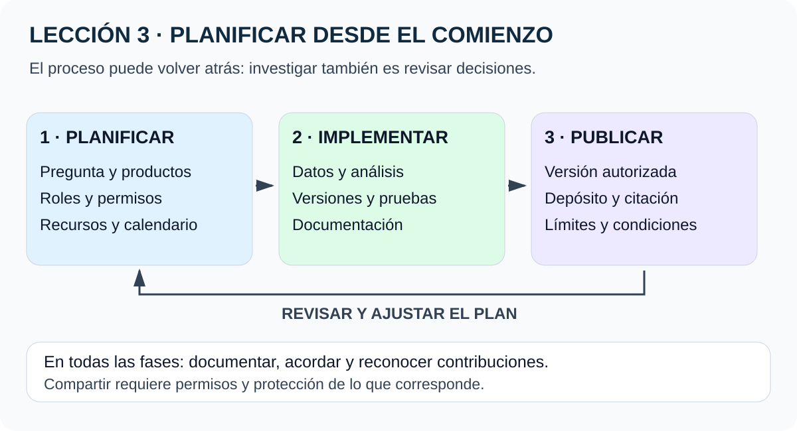
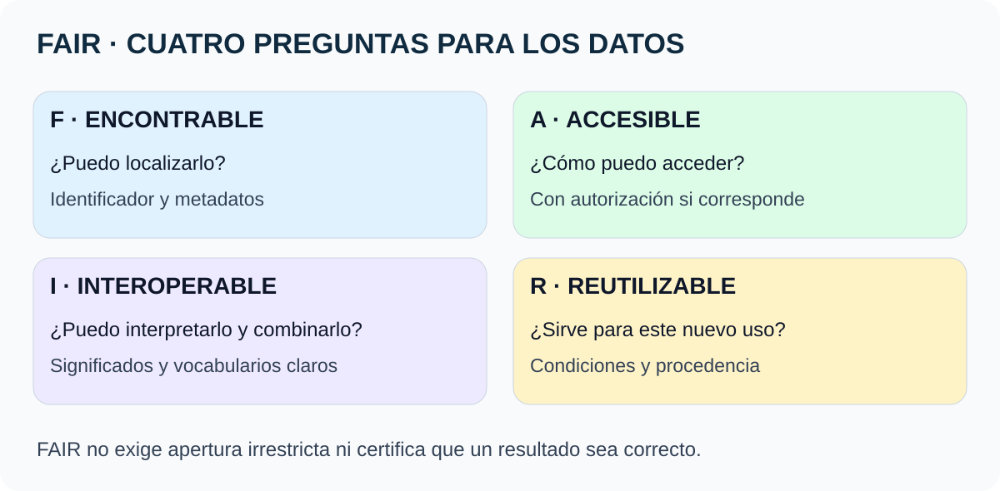
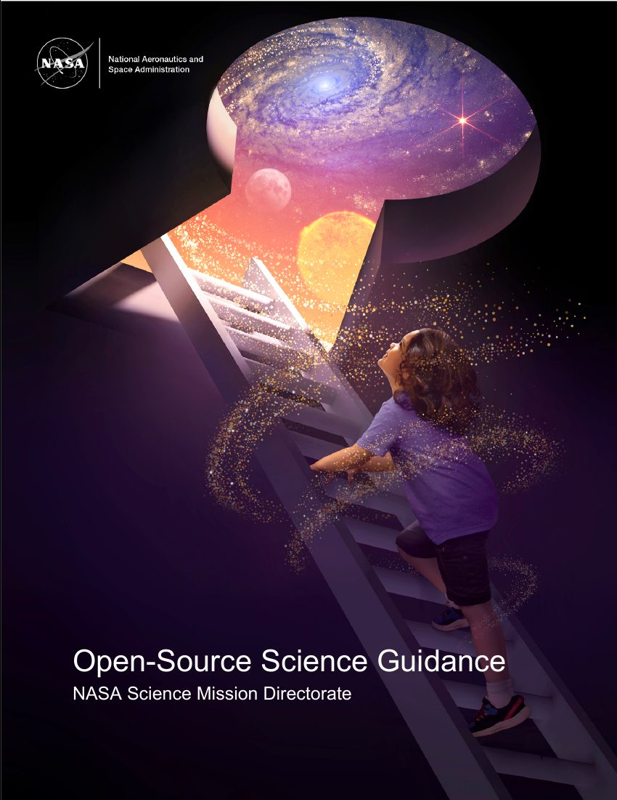

# Lección 3 · Planificación para la ciencia abierta

**Original:** Lesson 3 – Planning for Open Science  
**Curso:** Open Science Essentials · **Material:** disponible · **Comprensión:** pendiente de comprobar

[🏠 Inicio](../../../README.md) · [📘 Curso](../README.md) · [← Lección 2](02-preocupaciones-y-consideraciones.md)

## Elige cómo estudiar

[⚡ Resumen](#en-dos-minutos) · [🗺️ Mapa visual](#1-un-flujo-de-trabajo-con-idas-y-vueltas) · [🧩 FAIR](#4-fair-cuatro-preguntas-para-los-datos) · [📄 PDF y portada](#documento-del-curso-pdf-y-portada) · [✍️ Mini-plan](../anexos/03-mini-osdmp.md) · [🎯 Repaso](#comprueba-lo-que-entendiste)

## En dos minutos

La apertura se planifica desde el comienzo. Hay que acordar **qué se producirá, cómo se documentará, qué se compartirá, cuándo, dónde y quién será responsable**.

Un **OSDMP** es un Plan de Ciencia Abierta y Gestión de Datos. Abarca datos, software, publicaciones y responsabilidades. FAIR ayuda a que los productos sean encontrables, accesibles, interoperables y reutilizables; **no significa que todo deba ser público**.

## Qué podrás explicar

- Relacionar planificación, implementación y publicación con un producto concreto.
- Diferenciar un DMP, un SMP y el OSDMP más amplio.
- Interpretar las cuatro letras FAIR mediante ejemplos.
- Escribir una responsabilidad verificable y un plazo de revisión.
- Reconocer cuándo una instrucción pertenece a una convocatoria particular.

## 1. Un flujo de trabajo con idas y vueltas

**Síntesis del curso.** Se presentan tres fases: planificación, implementación y publicación o liberación. El curso atribuye este esquema general al currículo Opensciency; no todos los proyectos tienen idénticos hitos.

**La imagen en palabras:** primero se acuerdan productos, recursos y responsabilidades; después se producen y revisan materiales; al publicarlos se conservan contexto y condiciones. Una revisión puede obligar a volver atrás. La ciencia abierta atraviesa las tres fases.

| Fase | Qué decides o haces | Producto didáctico |
|---|---|---|
| Planificación | Pregunta, roles, datos, herramientas y condiciones de publicación | Un plan con responsables |
| Implementación | Recogida, análisis, control de versiones, documentación y revisión | Datos documentados y código trazable |
| Publicación / liberación | Depósito, licencia, citación y comunicación de límites | Una versión identificable y utilizable |

No hay que esperar al artículo final para documentar. Tampoco hace falta convertir cada prueba desechable en una publicación formal con DOI.

**Matiz de seguridad:** el fragmento sugiere que no hay daño en hacer público el código exploratorio. Aquí lo corregimos: el control de versiones puede ser privado y cualquier publicación requiere revisar permisos, secretos, datos y restricciones. Exploratorio no equivale a publicable.

## 2. Planificar la colaboración: ejemplo JWST

El curso presenta al equipo ERS-TRANSIT del James Webb como ejemplo de acuerdos tempranos sobre conducta, publicación y reconocimiento. La [página del programa](https://ers-transit.github.io/) ofrece datos y herramientas para estudiar atmósferas de exoplanetas.

Su [política de publicación, versión 1.0](https://ers-transit.github.io/documents/publication-policy-v1.0.pdf) trata coordinación, contribuciones y revisión de publicaciones. El propio PDF está fechado el **5 de marzo de 2018**, aunque el fragmento recibido lo cite como captura de 2023. No se confunde la fecha de una referencia con la fecha del documento.

**Enseñanza:** acordar cómo se trabaja antes de recopilar datos o escribir código reduce ambigüedades. Un [código de conducta](https://ers-transit.github.io/code-of-conduct.html) ayuda a establecer expectativas de participación; una política de publicación aborda otro tipo de decisiones.

El material del curso menciona casi 400 participantes y más de 40 publicaciones. Esas cantidades se conservan como afirmaciones del curso, **no como recuentos actuales verificados**. Tampoco el hallazgo de CO₂ debe interpretarse como prueba de vida.

## 3. Qué es un OSDMP

**Open Science and Data Management Plan:** Plan de Ciencia Abierta y Gestión de Datos. Es una hoja de ruta revisable: explica cómo se gestionarán los productos y cómo se cumplirán los compromisos acordados.

| Parte | Pregunta principal | Contenido típico |
|---|---|---|
| DMP — Data Management Plan | ¿Cómo trataré los datos? | Tipos, formatos, volumen, metadatos, acceso y preservación |
| SMP — Software Management Plan | ¿Cómo gestionaré el software? | Desarrollo, pruebas, dependencias, versiones, licencia y archivo |
| OSP — Open Science Plan | ¿Cómo compartiré resultados y favoreceré la participación? | Publicaciones, comunicación, actividades abiertas y formación |
| Roles y responsabilidades | ¿Quién hace cada tarea? | Responsable, revisión, plazo y evidencia |

**Correcciones de traducción:** OSDMP no es solo un plan de «datos abiertos». **SMD** es la dirección científica de NASA; **SMP** es el plan de software, no un organismo que financia la investigación. Reproducibility se traduce aquí como **reproducibilidad**, sin sustituirlo por replicabilidad.

### Gestionar no es exactamente lo mismo que compartir

- **Gestionar:** organizar archivos, validar datos, registrar cambios, definir permisos y mantener copias.
- **Compartir:** preparar una versión autorizada con documentación, condiciones de reutilización y un lugar de acceso.
- **Preservar:** conservar una versión para que pueda recuperarse e interpretarse después.

Un respaldo de trabajo no es necesariamente un archivo de preservación, y un repositorio de desarrollo no garantiza por sí solo conservación permanente.

## 4. FAIR: cuatro preguntas para los datos

**La imagen en palabras:** F permite localizar; A explica cómo acceder; I facilita combinar e interpretar; R permite valorar y realizar la reutilización.

| Letra | Inglés | Español | Pregunta sencilla |
|---|---|---|---|
| F | Findable | Encontrable | ¿Puedo localizar el producto y sus metadatos? |
| A | Accessible | Accesible | ¿Sé cómo solicitarlo o recuperarlo? |
| I | Interoperable | Interoperable | ¿Puedo interpretarlo y combinarlo con otros recursos? |
| R | Reusable | Reutilizable | ¿Conozco sus condiciones, procedencia y límites? |

Los [principios publicados por GO FAIR](https://www.gofair.foundation/fair-principles) dan precisión a estas preguntas. El bloque R no estaba desarrollado por completo en el fragmento recibido; se completa mediante esa fuente.

### F: encontrable

Identificadores persistentes, metadatos descriptivos y registro en un recurso de búsqueda ayudan a encontrar los datos. Los metadatos deben identificar inequívocamente el producto que describen.

**Ejemplo añadido:** «temperaturas, versión 1, fechas y unidades» informa mejor que un archivo llamado «final-final.csv».

### A: accesible

El acceso debe explicarse mediante un procedimiento definido. Puede incluir autenticación y autorización. Los metadatos pueden seguir disponibles aunque los datos dejen de estarlo.

**Corrección importante:** FAIR no exige dominio público ni acceso irrestricto. [GO FAIR A1.2](https://www.gofair.foundation/a1-2) reconoce restricciones éticas, legales o contractuales. La disponibilidad de un servidor tampoco implica preservación eterna.

### I: interoperable

No basta con poder abrir un archivo. Importan formatos, representación del conocimiento, vocabularios compartidos y referencias comprensibles entre recursos.

**Ejemplo añadido:** dos tablas pueden estar en CSV y usar significados distintos para «temperatura». Hay que indicar unidad, variable y contexto.

### R: reutilizable

La documentación debe permitir valorar si los datos sirven para un nuevo propósito. Incluye licencia o condiciones de uso, procedencia y estándares de la comunidad. [GO FAIR R1](https://www.gofair.foundation/r1).

**Ejemplo añadido:** saber cómo se calibró una medición puede ser esencial para decidir si se puede combinar con otra serie.

**Límite:** un DOI no certifica FAIR, y FAIR no certifica que una conclusión sea correcta. Son criterios para mejorar la gestión y reutilización.

## 5. DMP: datos antes, durante y después

Según el material recibido y la plantilla de la guía SMD, conviene especificar:

1. **Productos:** tipos, formatos, cantidades aproximadas y estándares.
2. **Metadatos:** qué documentación identifica y explica cada conjunto.
3. **Destino y plazos:** dónde se conservarán los datos y cuándo se compartirán.
4. **Restricciones:** qué no se abrirá y qué fundamento documentado lo explica.
5. **Responsables:** quién ejecutará y verificará cada compromiso.

No escribas «usaremos la nube» como único plan. Indica qué servicio o repositorio, qué versión, qué condiciones de acceso y cómo se mantendrá la interpretación.

## 6. SMP: gestionar y publicar software

El plan describe qué software se prevé crear o modificar, cómo se desarrollará y cómo se conservarán sus versiones. Debe explicar documentación, pruebas, dependencias y el momento y lugar de publicación.

La licencia se elige teniendo en cuenta titularidad y componentes externos. El curso menciona licencias permisivas en el contexto de investigación SMD, salvo restricciones. **No es una orden de relicenciar cualquier proyecto existente.** Consulta el [anexo legal de la lección 2](../anexos/02-aspectos-legales-codigo-abierto.md).

Si no se prevé desarrollar software, dilo y explica qué revisión se hará si esa previsión cambia. No inventes productos para rellenar una plantilla.

## 7. OSP: publicaciones, participación y reconocimiento

El plan puede identificar artículos, informes, materiales de conferencias y otros resultados. Para cada uno, define cómo se facilitará el acceso y qué versión se podrá compartir.

El curso presenta preprints, manuscritos aceptados, repositorios y publicación en acceso abierto como posibles vías. Sus condiciones dependen del financiador y de los derechos de publicación; un preprint no equivale necesariamente a la versión revisada por pares.

Otras acciones posibles son talleres abiertos, formación, participación ciudadana y preregistro. El preregistro deja constancia previa de un plan; no garantiza que la investigación carezca de sesgos o errores.

## 8. Roles, presupuesto y revisiones

**Ejemplo original para practicar:**

| Tarea | Responsable propuesto | Evidencia y momento |
|---|---|---|
| Documentar unidades y variables | Persona encargada de datos | Diccionario revisado antes del análisis |
| Identificar dependencias | Persona encargada de software | Lista asociada a la versión publicada |
| Revisar permisos | Responsable designado por el proyecto | Decisión registrada antes de divulgar |
| Preparar el depósito | Persona encargada de archivo | Registro y versión al liberar el producto |
| Revisar el plan | Coordinación y equipo | Historial de decisiones en hitos acordados |

En equipos pequeños una persona puede asumir varios roles. Lo importante es que no queden tareas sin responsable y se planifique la continuidad si alguien se marcha.

Presupuesta el tiempo y los recursos necesarios. Los límites de costes admisibles y las instrucciones de archivo deben comprobarse en la convocatoria, no deducirse de una tabla educativa.

## Documento del curso: PDF y portada

**Portada del documento original de NASA SMD**, reproducida como vista previa del PDF. No es el logotipo de este proyecto ni implica respaldo institucional.

**[Abrir el PDF completo: Open-Source Science Guidance v2.2, 05-02-2025](../../../assets/docs/SMD-Open-Source-Science-Guidance-v2.2-20250205.pdf)** · [Fuente oficial](https://assets.science.nasa.gov/content/dam/science/cds/open-science/SMD%20Open-Source%20Science%20Guidance%20v2.2%2020250205.pdf).

| Páginas del PDF | Qué encontrarás |
|---|---|
| 2–4 | Versión, índice, propósito y límites |
| 6–7 | OSDMP y orientación |
| 10–13 | Gestión e intercambio de datos |
| 14–18 | Gestión e intercambio de software |
| 24–25 | Apéndice B: plantilla de ejemplo OSDMP |

El archivo aportado coincide byte a byte con esa edición oficial. Se conserva **sin editar**; la vista previa renderiza su primera página. [Ficha de procedencia y derechos](../../../assets/docs/README.md).

La guía declara que **no establece por sí misma requisitos de política**. Además, una edición de 2025 no debe presentarse como auditoría de todas las reglas actuales.

## 9. De la plantilla a la convocatoria

La [página oficial ROSES OSDMP](https://science.nasa.gov/researchers/sara/faqs/OSDMP/) ofrece una plantilla opcional y explica una regla general de sección de dos páginas, con excepciones por programa. Hay que leer la convocatoria y sus instrucciones específicas, también para anonimización y presupuesto.

Por eso sustituimos «todas las agencias exigen lo mismo» por una pregunta verificable: **¿qué plan exige este financiador, en esta convocatoria y en esta fecha?**

El [anexo internacional](../anexos/03-planes-y-recursos-globales.md) reúne NASA, NSF, NIH, NOAA, ARC, Unión Europea, Wellcome y JST. Es un mapa de consulta; no declara que los ocho utilicen el mismo formato.

## Prueba tú · Actividad 3.1

Piensa en un proyecto anterior que puedas describir públicamente, o utiliza un análisis ficticio de temperaturas.

- ¿Había un DMP u OSDMP escrito?
- ¿Qué parte trataba de organizar los datos y resultados?
- ¿Qué parte trataba de compartirlos?
- ¿Qué papel tenía cada persona?
- ¿Qué te gustaría haber planificado antes?

Si no había un plan, reconocer esa ausencia es una respuesta válida. No inventes experiencia ni un documento que nunca existió.

**Ahora crea un mini-plan:** usa el [anexo práctico OSDMP](../anexos/03-mini-osdmp.md). Define un producto, un responsable, un plazo, una condición de acceso y una comprobación observable.

## Comprueba lo que entendiste

Preguntas originales; no son el examen oficial.

1. ¿La ciencia abierta empieza cuando se publica el artículo?

No. Incluye acuerdos, documentación y decisiones desde la planificación y durante la investigación.

2. ¿Las tres fases son una secuencia que nunca cambia?

No. Hay revisiones y retornos; el ciclo real suele ser iterativo.

3. ¿OSDMP significa únicamente un plan para hacer públicos todos los datos?

No. Abarca datos, software, publicaciones, participación y responsabilidades, con restricciones justificadas cuando proceda.

4. ¿FAIR obliga a eliminar controles de acceso?

No. Puede haber autenticación y autorización. FAIR y apertura irrestricta no son equivalentes.

5. ¿Dos tablas CSV son automáticamente interoperables?

No. También deben poder interpretarse sus variables, unidades, vocabularios y relaciones.

6. ¿Un DOI demuestra que los datos son correctos?

No. Identifica un objeto; no certifica la calidad del análisis.

7. ¿Basta con poner «el equipo» como responsable de todo?

Es demasiado ambiguo para comprobar tareas. Conviene asignar responsables identificables y mecanismos de revisión.

8. ¿Debes usar exactamente dos páginas para cualquier plan de cualquier agencia?

No. Es necesario comprobar el programa y su convocatoria. Los ejemplos del curso no son una regla universal.

9. ¿Puedes hacer público todo el código exploratorio sin revisar nada?

No. Deben comprobarse permisos y restricciones. El control de versiones puede mantenerse privado.

## Para escuchar o leer en voz alta

Planificar la ciencia abierta es acordar cómo se trabajará antes de publicar. Un OSDMP reúne decisiones sobre datos, software, publicaciones y responsabilidades. FAIR significa encontrable, accesible, interoperable y reutilizable. Los datos pueden requerir autorización: FAIR no significa publicarlo todo. El plan debe explicar quién hace cada tarea, cuándo se revisa y cómo se conserva una versión. Usa la plantilla como apoyo y verifica siempre las instrucciones de tu convocatoria.

**Este es un guion textual**, no un MP3. Puede utilizarse con lectura en voz alta si el dispositivo dispone de ella.

## Fuentes, ampliaciones y límites

Texto base: material bilingüe de la lección 3 aportado por el estudiante el 27-10-2026. El marcador «Pasted Content 8020 chars» no contiene ese bloque completo; no se presenta como si se hubiera recibido.

Se consultaron FAIR/GO FAIR, ROSES OSDMP, el PDF oficial v2.2 y los documentos del equipo ERS-TRANSIT. Se añadieron ejemplos, preguntas, diagramas y una plantilla educativa originales. Las cantidades de participantes y publicaciones no se verificaron como recuento actual.

Las traducciones se corrigen cuando confunden OSDMP, SMD/SMP, reproducibilidad y FAIR. La información normativa se presenta como orientación de consulta, sin afirmar cumplimiento de una propuesta real. El [anexo global](../anexos/03-planes-y-recursos-globales.md) registra los recursos y límites.

[← Lección 2](02-preocupaciones-y-consideraciones.md) · [📘 Curso](../README.md) · **Lección 4: pendiente de contenido.**
