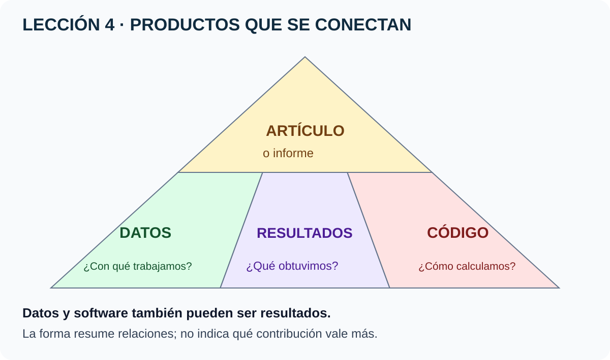
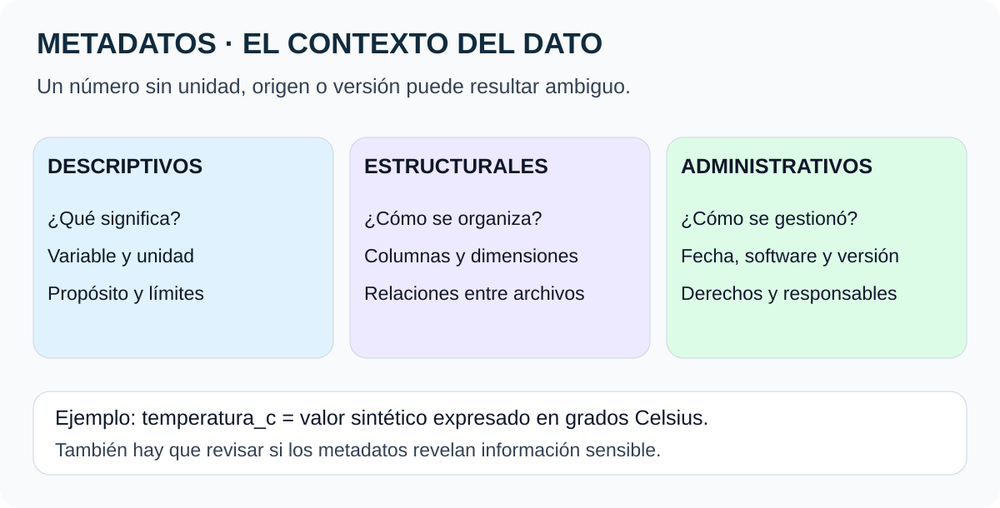
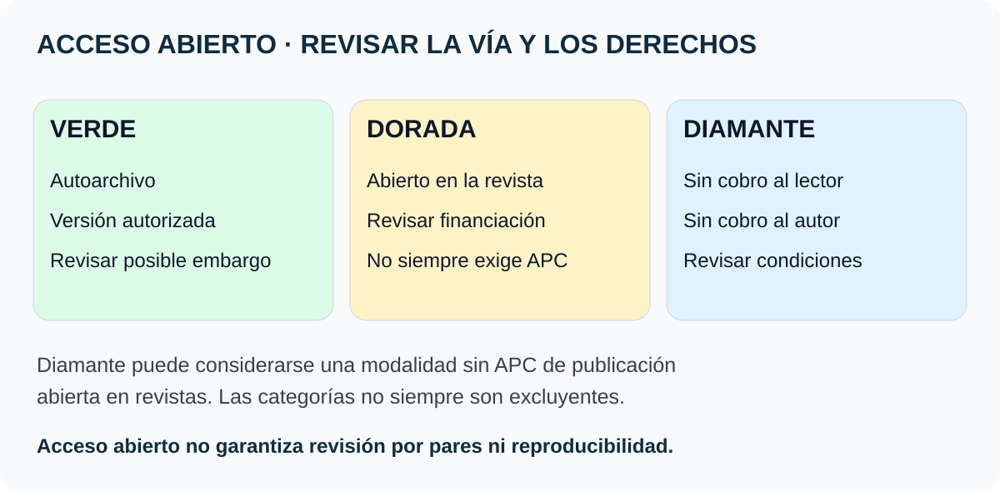

# Lección 4 · Componentes de la ciencia abierta

**Original:** Lesson 4 – Components of Open Science  
**Curso:** Open Science Essentials · **Material:** disponible · **Comprensión:** pendiente de comprobar

[🏠 Inicio](../../../README.md) · [📘 Curso](../README.md) · [← Lección 3](03-planificacion-ciencia-abierta.md)

## Elige cómo aprender

[⚡ Resumen](#en-dos-minutos) · [🔺 Imagen de componentes](#1-cuatro-componentes-conectados) · [🏷️ Metadatos](#3-metadatos-el-contexto-que-permite-usar-los-datos) · [📚 Acceso abierto](#8-publicar-en-acceso-abierto-verde-dorado-y-diamante) · [🧪 Ejemplo reproducible](../../../ejemplos/leccion-04/README.md) · [🎯 Repaso](#comprueba-lo-que-entendiste)

## En dos minutos

Una investigación produce **datos, código, resultados y publicaciones**. Compartir solo el artículo puede dejar fuera materiales necesarios para comprender y revisar cómo se llegó a sus conclusiones.

Cada producto necesita contexto: **qué es, de dónde viene, qué versión se utilizó, cómo se interpreta y con qué permisos puede reutilizarse**. Una publicación abierta no vuelve automáticamente abiertos sus datos ni reproducible su análisis.

## Qué podrás explicar

- Relacionar un conjunto de datos con el código, sus resultados y el artículo que los presenta.
- Distinguir datos primarios, secundarios y publicados sin tratarlos como categorías excluyentes.
- Reconocer metadatos descriptivos, estructurales y administrativos.
- Diferenciar formato abierto, licencia abierta y calidad de datos.
- Evaluar software y elegir una vía de publicación con criterios explícitos.
- Reconstruir un resultado pequeño con datos sintéticos.

## 1. Cuatro componentes conectados

**La imagen en palabras:** el artículo resume y explica; datos, resultados y código sostienen y documentan lo investigado. Es una representación didáctica, no una jerarquía de valor ni una obligación de crear cuatro archivos separados.

| Componente | Pregunta | Ejemplo |
|---|---|---|
| Datos | ¿Con qué observaciones o valores trabajamos? | Tabla de temperaturas |
| Código / software | ¿Qué procedimiento computacional aplicamos? | Programa que calcula promedios |
| Resultados | ¿Qué obtuvimos y qué podemos concluir? | Promedio y gráfica con límites |
| Artículo / informe | ¿Cómo explicamos la pregunta, el método y los hallazgos? | Informe que enlaza las versiones usadas |

**Solapamiento importante:** crear un conjunto de datos o software también puede ser un resultado de investigación. El curso presenta categorías útiles para organizar productos, no compartimentos cerrados.

También pueden compartirse protocolos, métodos y artefactos físicos. Sus permisos, documentación y condiciones de distribución deben tratarse específicamente.

### Un ejemplo real con productos identificables

El registro [Zenodo 3688691](https://zenodo.org/records/3688691) corresponde a **datos de entrada y salida de RRR/RAPID** asociados al trabajo *Underlying Fundamentals of Kalman Filtering for River Network Modeling*. No es el artículo ni el código completo.

- **Esta versión del conjunto:** [10.5281/zenodo.3688691](https://doi.org/10.5281/zenodo.3688691).
- **Conjunto de versiones:** [10.5281/zenodo.3688690](https://doi.org/10.5281/zenodo.3688690).
- **Artículo relacionado:** [10.1175/JHM-D-19-0084.1](https://doi.org/10.1175/JHM-D-19-0084.1).
- **Repositorio de software:** [c-h-david/rapid](https://github.com/c-h-david/rapid).

Se comprobaron los metadatos de Zenodo mediante su API y el README de RAPID. No se descargaron ni ejecutaron los datos o ese modelo. El texto completo del artículo devolvió 403.

Según la [guía de versionado de Zenodo](https://zenodo.org/help/versioning), citar la versión concreta permite identificar el artefacto usado; el DOI conceptual reúne las versiones. Un DOI no certifica calidad ni permiso para cualquier uso.

## 2. Datos abiertos y tipos de datos

**Síntesis del curso y contraste:** los datos abiertos pueden utilizarse, reutilizarse y redistribuirse bajo condiciones compatibles con su definición. Atribuir o compartir bajo condiciones equivalentes son obligaciones posibles, **no requisitos presentes en toda licencia**. [Open Data Handbook, español](https://opendatahandbook.org/guide/es/what-is-open-data/).

No basta con que el archivo pueda descargarse: revisa las condiciones de acceso y reutilización. Un conjunto con acceso restringido puede gestionarse con criterios FAIR sin ser abierto en el mismo sentido.

| Tipo | Cómo se define en la lección | Ejemplo |
|---|---|---|
| Primarios | Recogidos o generados directamente por el equipo | Mediciones propias o salidas de una simulación |
| Secundarios | Reutilizados por alguien distinto de quien los produjo | Una serie satelital obtenida de otro equipo |
| Publicados | Compartidos mediante un registro o canal de difusión | Un depósito documentado en un repositorio |

Las categorías dependen de la relación con el estudio: una serie puede ser primaria para quien la midió, secundaria para quien la reutiliza y publicada para ambos.

Para facilitar su reutilización, acompaña los datos con documentación, condiciones de uso, versión, historial y pasos de procesamiento. No todos los cuadernos preliminares o borradores tienen que publicarse; lo exigido depende del plan, derechos y convocatoria.

## 3. Metadatos: el contexto que permite usar los datos

**La imagen en palabras:** «qué significa», «cómo está organizado» y «cómo se gestionó» son preguntas diferentes y complementarias.

| Tipo | Qué explica | Ejemplo |
|---|---|---|
| Descriptivos | Contenido, propósito, variables y límites | «Temperatura simulada; grados Celsius; ejemplo educativo» |
| Estructurales | Organización, dimensiones, relaciones y formatos | Tres columnas, seis filas y relación entre fecha y sensor |
| Administrativos | Creación, software, versiones y gestión | Versión de los datos y del análisis, responsable y condiciones |

**Corrección:** los metadatos también pueden ser sensibles. Coordenadas, fechas precisas o información de participantes pueden revelar más de lo previsto. No se supone que son siempre pequeños, inocuos o publicables.

Los estándares ayudan a interpretar datos entre equipos:

- [CF Conventions](https://cfconventions.org/): describe variables y propiedades espacio-temporales, especialmente en ciencias de la Tierra.
- [WMO WIS 2.0](https://community.wmo.int/en/activity-areas/wis/wis2-implementation): recurso meteorológico citado por el curso; la apertura web agotó el tiempo en esta revisión.
- [NASA OSDR](https://science.nasa.gov/biological-physical/data/osdr/): contexto de datos de ciencias biológicas y físicas espaciales.

WIS 2.0 es un sistema más amplio de intercambio, no simplemente el nombre de un formato de archivo. Elegir un estándar requiere mirar el dominio y el repositorio de destino.

## 4. Formatos: abrir el archivo no basta

| Formato | Uso ilustrativo | Documentación primaria |
|---|---|---|
| CSV | Tablas de texto | [RFC 4180](https://www.rfc-editor.org/rfc/rfc4180) |
| HDF5 | Datos organizados en grupos y conjuntos | [The HDF Group](https://www.hdfgroup.org/solutions/hdf5/) |
| netCDF | Variables y datos científicos multidimensionales | [Unidata](https://docs.unidata.ucar.edu/netcdf-c/current/) |
| FITS | Imágenes y tablas astronómicas | [Estándar NASA/GSFC](https://fits.gsfc.nasa.gov/fits_standard.html) |

El texto recibido mezclaba algunos nombres y descripciones: esta tabla es una ampliación contrastada, no una reconstrucción literal de las diapositivas omitidas.

**Dos distinciones:** formato y licencia responden a preguntas distintas. Además, que un formato tenga especificación pública no garantiza compatibilidad perfecta entre todas las herramientas.

Un CSV no conserva automáticamente unidades, diccionario de variables ni precisión original. Una conversión puede perder capas o metadatos. Conserva el original cuando corresponda, documenta la transformación y comprueba que la salida sirve para el propósito previsto.

## 5. Para qué sirve compartir datos y qué límites existen

El curso presenta aplicaciones de emergencias, recursos naturales y participación ciudadana. El beneficio no procede solo de abrir archivos: también importan calidad, contexto, acceso y capacidad de uso.

| Caso del material | Idea para estudiar | Estado de la evidencia |
|---|---|---|
| Copernicus EMS | Mapas y datos para gestión de emergencias | El servicio oficial explica su combinación de imágenes satelitales y otros datos geoespaciales |
| Tsunamis y NOAA | Observaciones abiertas apoyan comprensión y preparación | Fuente NOAA consultada; no se evalúa aquí una alerta en curso |
| Huracán Ida y NASA | Compartir información puede apoyar respuesta y recuperación | Página NASA consultada |
| Pesca de marlín en Australia | Series históricas pueden informar estrategias de gestión | Referencia del curso; no se verificó un cambio de política atribuible a ese estudio |
| Calidad del agua en Líbano | Formación y participación local pueden ampliar la investigación | Caso narrado por el curso; no se contrastó completo el capítulo |
| Reconocimiento a investigadores africanos | Compartir también requiere equidad y reconocimiento | La referencia Nature aportada no basta para validar toda la narración del fragmento |

**Error de conversión:** 500 millas por hora equivalen aproximadamente a **805 km/h**, no a 300 km/h. NOAA explica que la velocidad en mar profundo puede superar 500 mph y depende de la profundidad. [NOAA](https://www.noaa.gov/jetstream/tsunamis/tsunami-propagation).

**Copernicus:** no se reduce a «datos recopilados por satélites ESA y NASA»; su componente cartográfico utiliza imágenes satelitales y otras fuentes. [CEMS Mapping](https://mapping.emergency.copernicus.eu/about/).

**NASA:** el [artículo sobre recuperación tras desastres](https://science.nasa.gov/open-science/artificial-intelligence-hurricane-response/) describe contribuciones de datos y modelos. No se presenta como medición de eficacia de un sistema creado en este repositorio.

Para el caso del Ébola, la [referencia de Maxmen de 2019](https://doi.org/10.1038/d41586-019-02258-4) se titula sobre investigación en una zona de guerra y el texto visible sitúa el contexto en la República Democrática del Congo. No se usa para confirmar sin más la narración sobre muestras de África Occidental de 2014–2016.

### Preguntas de responsabilidad

La apertura puede aumentar riesgos de identificación, malinterpretación o exposición de información protegida. Pregunta quién autoriza, quién aportó los datos y quién recibe los beneficios. Enlaza documentación de calidad y revisión; no confundas popularidad con validez científica.

## 6. Código abierto: derechos, no solo precio

El código fuente expresa instrucciones; el software puede reunir programas, datos y otros componentes. SciPy, Astropy y Matplotlib son ejemplos de bibliotecas que el curso menciona, sin que aquí se prueben sus versiones.

**Corrección fundamental:** el software abierto **puede distribuirse comercialmente**. La definición de OSI incluye derechos de redistribución y modificación; no se define exclusivamente por ser gratis ni por tener un repositorio público. [Open Source Definition](https://opensource.org/osd).

El curso cita cinco ideas de [The Open Source Way](https://opensource.com/open-source-way): transparencia, colaboración, publicación temprana e iterativa, inclusión de perspectivas y comunidad. Son orientaciones de colaboración, no una certificación automática de que un proyecto sea seguro o inclusivo.

### Cuatro preguntas antes de utilizar una herramienta

| Criterio | Pregunta observable |
|---|---|
| Funcionalidad | ¿Resuelve el problema y permite comparar con un resultado conocido? |
| Integración e interoperabilidad | ¿Puedo usar los formatos y dependencias que necesita? |
| Seguridad | ¿Su procedencia y forma de uso son compatibles con los controles del entorno? |
| Licencia y restricciones | ¿Tengo permiso para el uso y distribución previstos? |

No ejecutes un programa solo porque tenga muchas estrellas. Abrir el código facilita revisarlo, pero no elimina errores o malware. Para licencias y contribuciones, consulta el [anexo 2A](../anexos/02-aspectos-legales-codigo-abierto.md).

## 7. Resultados abiertos y reproducibilidad

Los resultados pueden incluir informes, artículos, datos, software, cuadernos, presentaciones, videos, podcasts o discusiones documentadas. No todos tienen revisión por pares ni el mismo propósito: identifica su estado.

Según la convención utilizada en las lecciones anteriores, reproducir implica obtener resultados computacionales consistentes con datos, procedimientos y condiciones identificados.

**Matiz:** no se exige siempre igualdad bit a bit, pero tampoco se acepta cualquier diferencia. Define previamente el criterio adecuado: puede ser igualdad exacta, tolerancia numérica o consistencia estadística justificada. Cambiar datos o método puede cambiar lo que se está comprobando.

Herramientas que ayudan a reunir código, explicación y salidas:

- [Jupyter](https://jupyter.org/): cuadernos computacionales.
- [Jupyter Book](https://jupyterbook.org/): publicación de narrativas computacionales.
- [R Markdown](https://rmarkdown.rstudio.com/): documentos que combinan narración y código.
- [Quarto](https://quarto.org/): publicación de documentos computacionales.
- [The Turing Way](https://book.the-turing-way.org/reproducible-research/overview/overview-definitions/) y [FORRT](https://forrt.org/): formación y prácticas.

Son ayudas, no garantías. Un cuaderno puede depender de celdas ejecutadas fuera de orden o archivos no compartidos. No se instala ninguna herramienta ni se provisiona un servicio como parte de esta lección.

### Documenta para tu yo del futuro

Para datos: resumen, unidades, origen, errores conocidos y transformaciones. Para código: uso, dependencias, versión y cambios. Para resultados: pregunta, método, productos utilizados, interpretación y límites.

Un artículo de acceso abierto puede seguir siendo irreproducible si faltan sus materiales y procedimientos.

## 8. Publicar en acceso abierto: verde, dorado y diamante

| Ruta | Qué caracteriza la vía | Qué debes revisar |
|---|---|---|
| Verde | Autoarchivo de una versión autorizada en un repositorio | Versión, derechos y embargo cuando corresponda |
| Dorada | El artículo se publica en acceso abierto en la revista | Modelo de financiación y condiciones de la publicación |
| Diamante | No se cobra al lector ni al autor por publicar | Condiciones de la revista y sostenibilidad |

**Corrección:** no toda publicación científica cobra APC, ni «dorado» significa necesariamente que el autor pague. El diamante suele describirse también como una modalidad sin APC dentro de la publicación abierta en revistas; las etiquetas no forman siempre tres conjuntos excluyentes.

Se omiten los rangos de precios del fragmento como tarifas universales o vigentes. Para presupuestar hay que consultar la revista, la fecha, las posibles exenciones y los acuerdos aplicables. [The Turing Way: acceso abierto](https://book.the-turing-way.org/reproducible-research/open/open-access/) · [cOAlition S: diamante](https://www.coalition-s.org/diamond-open-access/).

Los informes de USGS son otro ejemplo de difusión pública de resultados. No sustituyen automáticamente una revisión por pares ni tienen todos idénticos derechos sobre componentes externos. [Publicaciones USGS](https://pubs.usgs.gov/).

## Prueba tú · Actividad 4.1

Recuerda un proyecto que puedas describir públicamente:

1. ¿Qué productos compartiste y por qué medios?
2. ¿Qué beneficio observaste realmente?
3. ¿Qué medio adicional facilitaría revisión o colaboración?
4. ¿Qué documentación y permisos necesitarías?

Si no tienes experiencia previa, utiliza el [paquete ficticio de esta lección](../../../ejemplos/leccion-04/README.md): datos sintéticos, diccionario, cuaderno y un informe de resultados.

Ver una respuesta modelo

Compartiría una tabla sintética documentada, el procedimiento de cálculo y un informe que distinga el ejemplo de observaciones reales. Otra persona podría comprobar el promedio y sugerir correcciones. Elegiría un repositorio con versión y condiciones claras. No afirmaría que hubo colaboración hasta recibir y registrar una revisión real.

## Comprueba lo que entendiste

Preguntas originales, distintas del examen oficial.

1. ¿Los datos primarios también pueden estar publicados?

Sí. Primario describe su relación con quien los genera; publicado describe su difusión. No son categorías excluyentes.

2. ¿Los metadatos nunca contienen información sensible?

Pueden contenerla. Ubicaciones, fechas y otros detalles deben revisarse antes de compartir.

3. ¿Un CSV descargable demuestra que los datos son abiertos y reutilizables?

No. También importan licencia, significado, unidades, documentación y restricciones.

4. ¿Para reproducir una ejecución conviene identificar la versión concreta?

Sí. El DOI de versión o un identificador equivalente reduce ambigüedades respecto al artefacto utilizado.

5. ¿Todo software de código abierto es necesariamente gratuito?

No. Sus derechos y condiciones lo definen; se permite distribución comercial compatible con la licencia.

6. ¿Basta con compartir un cuaderno para garantizar reproducibilidad?

No. Deben estar disponibles los datos, dependencias, pasos y condiciones necesarias, con un criterio de consistencia.

7. ¿Reproducibilidad significa que cualquier diferencia numérica es aceptable?

No. Hay que definir y justificar el criterio apropiado, que puede requerir igualdad exacta en algunos casos.

8. ¿La vía verde permite subir cualquier PDF editorial?

No. Se comprueban la versión autorizada, los derechos y posibles condiciones de depósito.

9. ¿Todos los autores de revistas abiertas deben pagar APC?

No. Existen modelos sin cobro al autor, como diamante, y otros mecanismos de financiación.

10. ¿Publicar más formatos demuestra mayor calidad científica?

No. Puede mejorar alcance y accesibilidad, pero la calidad requiere examinar método, evidencia e interpretación.

## Para escuchar o leer en voz alta

Los componentes de la investigación están conectados. Los datos muestran con qué trabajamos; el código explica el cálculo; los resultados expresan lo obtenido y el informe reúne contexto y conclusiones. Para reutilizarlos necesitamos versiones, permisos y documentación. Los metadatos explican contenido, estructura y gestión. Código abierto no significa siempre gratuito, y acceso abierto no significa siempre pagar. Una buena entrega permite seguir el recorrido, comprobarlo y reconocer sus límites.

**Guion textual para una función de voz disponible en el dispositivo; no hay MP3 generado.**

## Fuentes y límites

Base: texto bilingüe compartido por el estudiante el 28-10-2026. Las repeticiones se organizaron sin duplicarlas. Los espacios vacíos en la lista de formatos y tipos de software no se presentan como diapositivas completas recuperadas.

Se contrastaron Open Data Handbook, OSI, Zenodo mediante API, README de RAPID, CF, OSDR, documentación de formatos, fuentes de acceso abierto, herramientas y ejemplos oficiales NOAA/Copernicus/NASA. Algunas fuentes agotaron el tiempo o devolvieron 403; el [anexo de recursos](../anexos/04-recursos-y-fuentes.md) conserva esos límites.

Las referencias del curso sobre reutilización (Hemphill), pesca (Guillemin), Beirut (Chan) y taller de datos (El-Gebali) se incluyen como lecturas, sin afirmar revisión íntegra. La referencia de Maxmen no se usa para confirmar un relato que no coincide con su contexto visible.

[← Lección 3](03-planificacion-ciencia-abierta.md) · [📘 Curso](../README.md) · **Lección 5: pendiente de contenido.**
