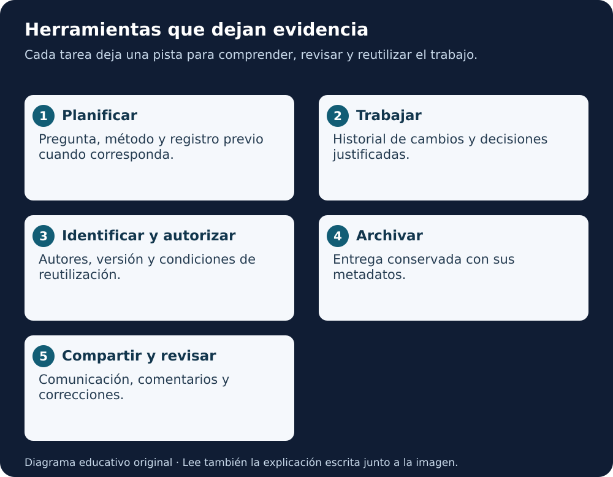
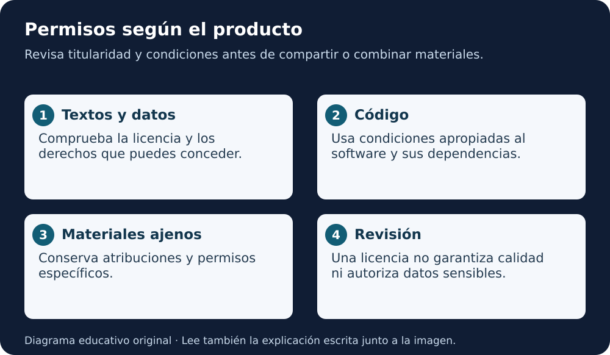

# Lección 5 · Herramientas para la ciencia abierta

🎧 [Escuchar o descargar esta lección en español](../../../audio/essentials/leccion-05.mp3) · Voz sintética. [Detalles y descargas](../../../audio/essentials/README.md).

**Título original:** Tools for Open Science  
**Curso:** Open Science Essentials · **Estado:** disponible para estudiar; práctica y dominio pendientes.

[← Lección 4](04-componentes-ciencia-abierta.md) · [Índice del curso](../README.md) · [Próximos pasos →](../proximos-pasos.md) · [Inicio](../../../README.md)

## En dos minutos

Una herramienta de ciencia abierta te ayuda a **encontrar, producir, revisar, conservar o compartir** conocimiento. Puede ser un programa, un repositorio, un identificador, una licencia, un plan o una comunidad que te acompañe.

No necesitas utilizar todas las herramientas. Elige las que resuelvan una necesidad concreta y permitan explicar **qué hiciste, con qué versión, bajo qué permisos y cómo comprobarlo**. Una herramienta gratuita no necesariamente es abierta, y una herramienta abierta puede tener costes de alojamiento, curación o soporte.

## Qué podrás explicar

- Distinguir preprint, manuscrito aceptado y artículo editorial.
- Elegir un repositorio y diferenciar desarrollo activo de preservación.
- Relacionar control de versiones, DOI, ORCID y licencia sin confundir sus funciones.
- Explicar cuándo un plan es un prerregistro y cómo declarar cambios.
- Evaluar usos de IA con verificación humana, respeto de permisos y protección de información.

## Mira el recorrido

**Equivalente escrito:** antes de analizar, deja un plan; durante el trabajo, conserva cambios y decisiones; antes de compartir, identifica autores y permisos; al publicar, archiva la versión relevante; después, recibe correcciones y comunica las nuevas versiones. La revisión ética y la documentación atraviesan todas las tareas. El recorrido admite volver atrás.

## 1. Qué cuenta como herramienta

El texto compartido presenta cinco usos: encontrar recursos, procesar productos, crear contenido, compartir o archivar y comunicar investigación. Una comunidad es infraestructura humana: puede ayudarte a elegir estándares, aprender una herramienta o reconocer un problema ético.

| Necesito… | Herramienta o práctica | Evidencia que deja |
|---|---|---|
| Explicar qué quiero investigar | Plan y prerregistro, cuando corresponda | Pregunta, métodos y fecha |
| Saber qué cambió | Git y una plataforma colaborativa | Commits, diferencias y revisión |
| Identificar persona y producto | ORCID y DOI | Referencias persistentes |
| Dar permisos de reutilización | Licencias adecuadas al producto | Condiciones explícitas |
| Conservar una entrega | Archivo de investigación | Versión identificada y metadatos |
| Encontrar problemas | Revisión y comunidad | Comentarios, correcciones y límites |

**Ejemplo didáctico:** para una tabla sintética de temperaturas basta empezar con CSV, diccionario, historial y README. Un modelo complejo necesita además registrar entrenamiento, evaluación y condiciones de ejecución. La cantidad de herramientas depende del trabajo.

## 2. Preprints: compartir antes, indicando el estado

Un **preprint** es una versión del manuscrito compartida habitualmente antes de la revisión por pares. Permite comunicar resultados y recibir comentarios con rapidez. El manuscrito aceptado tras revisión se denomina **accepted author manuscript** o, en muchos contextos, **postprint**. La **version of record** es la publicación editorial definitiva. El texto recibido emplea “preprint” en un sentido más amplio; aquí distinguimos las etapas para evitar confusiones.

| Versión | Qué se sabe | Qué comprobar |
|---|---|---|
| Preprint | Puede no haber pasado revisión por pares | Fecha, versión, métodos, correcciones y estado |
| Manuscrito aceptado | Incluye los cambios de la revisión | Permiso de depósito y enlace al artículo |
| Versión editorial | Tiene edición y presentación de la revista | Avisos posteriores, licencia y datos asociados |

**Ventajas:** difusión temprana, comentarios, visibilidad y acceso. **Límites:** errores sin detectar, interpretación prematura y políticas editoriales distintas. La revisión por pares tampoco garantiza ausencia de errores.

arXiv, bioRxiv y medRxiv son ejemplos de servidores especializados; no todos aceptan los mismos temas o tipos de documentos. Consulta sus normas antes de depositar. La moderación de un servidor no equivale a revisión por pares.

**Al citar:** indica que es un preprint y usa la versión concreta. Si existe un artículo posterior, compáralo y normalmente cita la versión publicada pertinente. Ser antiguo o haber recibido un rechazo editorial no convierte automáticamente un trabajo en incitable: importa su calidad, estado y relevancia. No uses un preprint retirado como evidencia vigente sin explicar su situación. Esta es una precisión educativa frente a la regla absoluta del texto aportado.

**Práctica:** encuentra en el [PDF de AGU](../../../assets/docs/AGU-Etica-IA-ML-2023-v1.pdf) la advertencia de preprint y su DOI versionado. No supongas que la licencia o el DOI acreditan revisión por pares.

## 3. Repositorio activo y archivo de preservación

Un repositorio organiza productos y sus descripciones. Algunos sirven para colaborar a diario; otros se orientan a preservar entregas. Estas funciones pueden coexistir: no son una separación absoluta entre herramientas.

**GitHub** facilita desarrollo e historial. **Zenodo** permite depositar y describir versiones de investigación con DOI. La integración entre ambos requiere configuración y revisión: crear un repositorio público no produce por sí solo un DOI ni un depósito.

Archivar no significa “software probado y seguro”. Un archivo puede conservar un resultado con errores, un preprint o una versión retirada con su aviso. La preservación mantiene evidencia; la calidad requiere evaluación.

### Escoger dónde depositar

Primero revisa la convocatoria y la institución. Después busca el archivo reconocido por tu disciplina. Si no existe, compara repositorios generales:

- Aceptación del tipo de producto y de sus formatos.
- Identificador, metadatos, versiones y relación con publicaciones.
- Preservación, condiciones de retirada y exportación.
- Acceso abierto o controlado según sensibilidad.
- Costes de depósito, tamaño, curación y soporte.

Los datos sensibles requieren un servicio y una gobernanza adecuados. Un repositorio público genérico no debe usarse como solución automática.

### Ejemplos del curso, ordenados por función

| Función | Ejemplos | Límite importante |
|---|---|---|
| Datos especializados | Protein Data Bank, GenBank, IDR, EMPIAR, OpenNeuro | Estándares y requisitos de cada comunidad |
| Archivo general | Zenodo, Dryad; instalaciones de Dataverse | Aceptación y costes varían |
| Gestión y colaboración | OSF, GitHub | Confirmar qué parte preserva y qué parte permite editar |
| Infraestructura de identificadores | DataCite | No es un repositorio general para subir cualquier archivo |

Dataverse es también software para operar repositorios; cada instalación define sus servicios. Dryad contempla costes de publicación y posibles coberturas institucionales; no se limita a una “suscripción”. No se comparan precios ni se recomienda pagar.

## 4. Control de versiones: entender el historial

Un **commit** registra un estado de los archivos con un mensaje. Una **rama** permite desarrollar una línea de cambios. Una **pull request** propone integrar cambios para revisarlos. Una **etiqueta** puede señalar una entrega; no demuestra que esa entrega haya sido validada.

Git es distribuido: una copia completa del repositorio puede contener su historial. GitHub es una plataforma que aloja repositorios Git y añade colaboración. Usar una plataforma central no transforma Git en un sistema centralizado. SVN es un ejemplo de control centralizado; Git y Mercurial, de distribuido.

**Corrección de actualidad:** Bitbucket Cloud retiró el soporte de Mercurial en 2020. El ejemplo recibido que lo presenta como soporte vigente quedó desactualizado.

### Colaborar desde GitHub

- **Issues:** registrar un problema o propuesta con contexto.
- **Discussions:** conversar y construir comunidad, si están habilitadas.
- **Pull requests:** revisar una propuesta antes de incorporarla.
- **Revisión de diferencias:** identificar qué cambió realmente.
- **Permisos:** definir quién puede proponer y quién puede integrar.

**Desde iPad:** abre un archivo del repositorio y consulta su historial cuando la interfaz lo permita. Puedes leer sin instalar Git. Para editar, utiliza las funciones disponibles de GitHub o su versión web. Antes de confirmar, revisa la rama, los cambios y que no haya datos privados.

Un historial es evidencia de cambios, no garantía de respaldo externo ni de corrección. Git no es apropiado para introducir indiscriminadamente datos enormes o sensibles. Borrar un dato de la última versión puede dejarlo en el historial.

## 5. Identificadores persistentes: persona, producto y versión

Un PID es una referencia diseñada para mantenerse en el tiempo.

| Identificador | Identifica principalmente | No demuestra |
|---|---|---|
| ORCID iD | Persona investigadora y vínculos con sus contribuciones | Título profesional, competencia o validación de todos sus datos |
| DOI | Un producto registrado y su ficha persistente | Calidad, revisión por pares o veracidad |
| Hash de commit | Un estado del historial Git | Preservación indefinida o un DOI |

El apartado DOI quedó sin desarrollo en el fragmento recibido. **Ampliación verificada:** ORCID distingue identificadores de personas y de productos; Zenodo permite conservar entregas y relacionar sus versiones. Un DOI debe resolver a información que permita identificar el objeto y acceder a él según sus condiciones.

Puedes citar una versión concreta para reproducir un análisis o un identificador de conjunto de versiones para referirte al proyecto. Comprueba cuál estás usando. No inventes un DOI ni un ORCID para completar una ficha.

## 6. Licencias: permisos que acompañan al producto

Que un archivo pueda leerse no concede todos los permisos de reutilización. Identifica titularidad, licencia, condiciones y posibles materiales de terceros. La ausencia de licencia no elimina excepciones legales o dominio público, pero tampoco permite asumir una autorización general.

**Equivalente escrito:** identifica qué material es tuyo, qué pertenece a otras personas y quién puede autorizar su difusión. Elige condiciones apropiadas al texto, los datos o el código. Conserva los avisos ajenos. Después comprueba que la combinación respete todos los permisos.

| Instrumento | Idea principal |
|---|---|
| CC0 | Dedicación al dominio público en la medida legalmente posible; no elimina privacidad, patentes o marcas |
| CC BY | Permite compartir y adaptar con atribución e indicación de cambios |
| CC BY-SA | Añade condiciones de licencia para adaptaciones compartidas |
| CC BY-NC | Restringe usos comerciales |
| CC BY-ND | Restringe compartir adaptaciones; no es una prohibición absoluta de toda modificación privada |

NC y ND limitan la reutilización y no satisfacen todas las definiciones de contenido abierto. SA no prohíbe uso comercial. No existe una única escala que permita comparar todas las combinaciones sin contexto.

Para software suelen usarse licencias específicas como MIT, BSD o Apache, y otras con copyleft según el proyecto. No traslades automáticamente Creative Commons al código. Consulta el [anexo legal de la lección 2](../anexos/02-aspectos-legales-codigo-abierto.md).

**Precisión jurídica:** recibir fondos públicos de EE. UU. no pone automáticamente toda investigación en dominio público. La regla sobre obras del Gobierno federal y la titularidad de obras de contratistas o beneficiarios son asuntos diferentes. Revisa autoría, contrato, jurisdicción y política aplicable.

### Caso CMIP6

Los términos de uso versión 6.2 explican que las restricciones de grupos participantes se relajaron en octubre de 2022 hacia CC BY 4.0 y remiten a información actualizada por modelo, incluso cuando un encabezado antiguo indique otra licencia. El ejemplo enseña a **comprobar condiciones y versión**, no a inferir una licencia común para todo dato climático o todo producto posterior. No repetimos como hecho que cada empresa afectada tuvo que rehacer sus modelos: ese detalle causal no se comprobó.

## 7. Prerregistro: declarar el plan antes de la actividad

Prerregistrar consiste en especificar un plan y depositarlo en un registro antes de realizar la actividad que se quiere registrar. Puede aplicarse antes de recolectar datos o antes de analizar datos existentes, declarando lo que ya se conoce de ellos.

Ayuda a distinguir hipótesis y análisis previstos de exploraciones posteriores. No demuestra prioridad legal, no impide todo sesgo y no garantiza un resultado válido. Los cambios pueden ser necesarios: se justifican y se fechan, conservando el plan anterior.

| Práctica | Qué aporta |
|---|---|
| Prerregistro estándar | Registro fechado de pregunta, diseño y análisis previstos |
| Registered Report | Evaluación editorial de pregunta y método antes de conocer resultados; aceptación condicionada al cumplimiento |
| Registered Replication Report | Informe registrado orientado a replicar un hallazgo |
| Compartir una propuesta financiada | Transparencia del plan; no equivale necesariamente a un prerregistro |

Algunos registros permiten embargo. Una propuesta subida después del análisis no se convierte retrospectivamente en plan previo.

El **New Technology Report** de NASA es un mecanismo de comunicación de nuevas tecnologías e invenciones. No lo equiparamos a un prerregistro de hipótesis y análisis: tienen finalidades distintas.

La encuesta citada por el curso corresponde a ciencias sociales, no a todas las disciplinas. Sus porcentajes no son una tasa universal de adopción; la referencia y su contexto se conservan en el [anexo de fuentes](../anexos/05-recursos-y-precisiones.md).

## 8. Herramientas para revisar FAIR

FAIR significa encontrable, accesible, interoperable y reutilizable; no significa “justo”, “precio” o una certificación general de calidad.

| Herramienta presentada | Tipo de ayuda | Cómo interpretar su salida |
|---|---|---|
| ARDC FAIR self-assessment | Preguntas para discutir la preparación de los datos | Orientación inicial; servicio concreto pendiente de comprobar |
| F-UJI | Evaluación automatizada de características FAIR | Revisa qué pudo detectar de metadatos y del recurso |
| FAIR Evaluation Services | Evaluación configurable descrita por el curso | Disponibilidad y configuración no comprobadas aquí |
| FAIR-Checker | Análisis relacionado con metadatos y estándares semánticos | Indicadores y mejoras, no garantía científica |

Una puntuación depende de versión, criterios y acceso del evaluador. Una herramienta puede no detectar metadatos existentes; un recurso bien descrito puede contener datos incorrectos. Guarda fecha, identificador evaluado, configuración e informe. No enviamos datos del estudiante a estos servicios.

## 9. IA: asistencia verificable durante el trabajo

El texto recibido y la página NASA consultada utilizan **Super Intelligence (SI)**. Conservamos esa denominación al referirnos a la fuente; para explicar técnicas usamos **IA**, **aprendizaje automático (ML)** e **IA generativa**. El nombre institucional no demuestra inteligencia general, autonomía científica ni una capacidad concreta.

La página NASA organiza su trabajo en predicción, ciencia abierta, colaboración entre disciplinas e infraestructura. En esta lección eso se traduce en preguntas prácticas: ¿ayuda a encontrar datos?, ¿qué valida la predicción?, ¿qué fuentes combina?, ¿cómo protege y conserva el proceso?

### Uso responsable, con ejemplos

| Tarea posible | Revisión humana necesaria |
|---|---|
| Borrador de código | Leer, probar entradas y comprobar resultados frente a una referencia |
| Traducción o explicación | Comparar con el original y conservar términos técnicos |
| Buscar bibliografía | Abrir cada referencia y verificar autoría, contenido y estado |
| Resumir documentos | Revisar cobertura, omisiones y límites de acceso |
| Preparar una figura | Comprobar datos, ejes, incertidumbre y declarar el procedimiento |

Un texto convincente no es evidencia. Un modelo puede inventar citas, confundir versiones o producir código incorrecto. Tampoco una salida semejante a otro texto demuestra por sí sola una infracción: hay que revisar el material y sus condiciones.

**Antes de usar IA:** define el propósito, comprueba si puedes compartir la entrada, evita información confidencial, fija una comprobación independiente y registra herramienta, fecha y uso. Sigue las políticas vigentes de tu institución, revista o convocatoria. La responsabilidad de los autores permanece.

**Caso NIH:** el aviso de 2023 citado se refiere a revisores de solicitudes y contratos de I+D y a la confidencialidad de ese proceso. No establece por sí mismo una prohibición universal de IA en toda investigación o toda solicitud. Las reglas de solicitantes y de otros financiadores se consultan aparte. No subas material de revisión confidencial a un asistente público.

Para estudiar estas decisiones con profundidad, abre el [módulo AGU de ética de IA/ML](../../../modulos/etica-ia-agu/README.md). La [guía NASA en español](../../../modulos/guia-nasa-smd/README.md) conecta documentación, datos, software y preservación.

## 10. Práctica guiada: prepara una entrega sin publicarla aún

Utiliza únicamente el [ejemplo sintético de la lección 4](../../../ejemplos/leccion-04/README.md).

1. Identifica datos, código, informe y sus licencias.
2. Elige una versión del historial para describirla. No inventes un DOI.
3. Explica qué dejarías en GitHub y qué conservarías en un archivo.
4. Redacta metadatos: título, autores reales, fecha, versión, descripción y relación entre productos.
5. Describe una tarea en la que IA podría ayudar y cómo comprobarías la salida.
6. Señala qué paso requiere permisos o revisión antes de depositar.

**Criterio de revisión:** otra persona entiende qué producto es, con qué versión se trabajó, qué puede reutilizar y cómo verificarlo. Este ejercicio no crea cuentas, no deposita en Zenodo ni envía respuestas a Canvas.

## Comprueba lo que entendiste

Preguntas originales de práctica, distintas del examen oficial.

1. Un artículo tiene DOI. ¿Ya sabemos que pasó revisión por pares?

No. El DOI identifica el producto; debes revisar su tipo, versión y estado editorial. El PDF AGU tiene DOI y declara ser preprint.

2. GitHub muestra un historial completo. ¿Eso sustituye un depósito de preservación?

No necesariamente. Comprueba las funciones de preservación exigidas y conserva una entrega con sus metadatos en el archivo apropiado. Una integración con Zenodo requiere activación y comprobación.

3. ¿CC BY-SA impide un uso comercial?

No. SA se refiere a las condiciones para compartir adaptaciones; NC es la condición que restringe usos comerciales. Hay que leer la licencia completa.

4. Analicé los datos ayer y registro hoy mi hipótesis como previa. ¿Es correcto?

No debes presentar ese análisis como prerregistrado. Describe lo que ya conocías y registra, si procede, una nueva actividad antes de iniciarla.

5. Una evaluación automática FAIR da una puntuación alta. ¿Los resultados ya son verdaderos?

No. Evalúa características de gestión y descripción, no la verdad de las conclusiones, la ausencia de sesgo ni toda obligación ética.

6. Una IA propone cinco citas. ¿Qué necesito antes de incluirlas?

Comprobar existencia, autores, fecha, versión y que cada fuente sostenga la afirmación correspondiente. Guarda las referencias que realmente revisaste.

## Actividad 5.1 · Reflexión personal

El curso pide pensar durante cinco minutos en usos de estas herramientas en estudios o proyectos anteriores. Anota un uso que hayas realizado de verdad, uno que sería útil y uno inapropiado. Para cada caso explica el dato de entrada, el beneficio, el riesgo y la revisión necesaria. Si no has usado IA en investigación, dilo y trabaja con un caso hipotético claramente identificado.

## Para leer en voz alta

“Una herramienta debe resolver una necesidad. El historial explica los cambios. El identificador permite reconocer el producto. La licencia comunica permisos. El archivo conserva una versión. El prerregistro diferencia lo planeado de lo exploratorio. La inteligencia artificial puede ayudar, pero sus salidas necesitan comprobación y una persona responsable.”

Este es un guion textual; también está disponible la lectura automática en MP3.

## Recursos, procedencia y límites

- **ES · lectura y práctica:** [anexo legal](../anexos/02-aspectos-legales-codigo-abierto.md), [guía NASA](../../../modulos/guia-nasa-smd/README.md) y [ética AGU](../../../modulos/etica-ia-agu/README.md).
- **EN y ES · referencias:** [fuentes y precisiones de esta lección](../anexos/05-recursos-y-precisiones.md), con enlaces institucionales y límites de acceso.
- **Base:** texto bilingüe aportado por el estudiante el 02-11-2026, apartado Tools for Open Science. Redacción educativa propia; se corrigen traducciones como “ciencia de próxima generación” y “verificador de precios”.
- **Ampliaciones:** aclaración DOI, precisión de versiones, permisos y ejemplos sintéticos. No se accedió a Canvas ni se copió su evaluación.
- Los espacios vacíos del contenido pegado no se reconstruyen como si se hubieran recibido imágenes o elementos interactivos.
