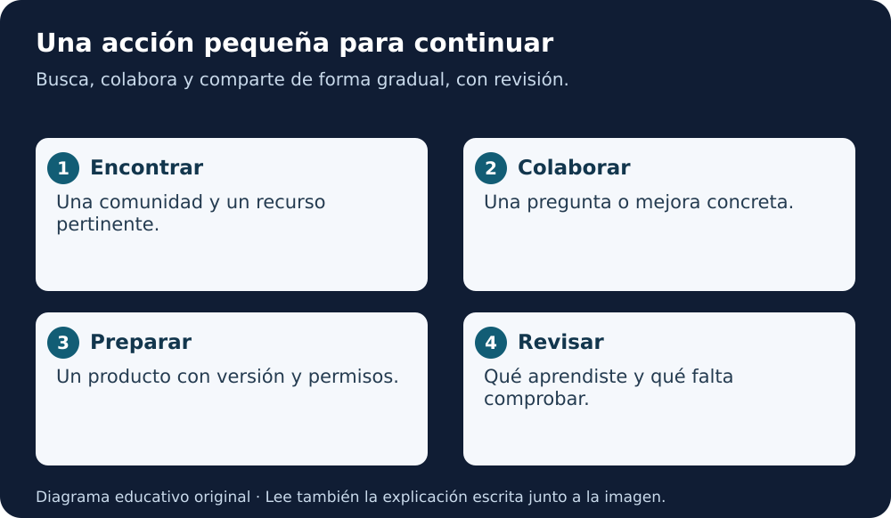

# Próximos pasos · Continúa tu camino en ciencia abierta

**Título original:** Next Steps…  
**Curso:** Open Science Essentials · contenido aportado por el estudiante el 02-11-2026.

[← Lección 5](lecciones/05-herramientas-ciencia-abierta.md) · [Índice](README.md) · [Preparar evaluación](evaluacion.md) · [Inicio](../../README.md)

## Empieza con una acción posible

El cierre del curso propone adoptar prácticas gradualmente según la naturaleza y alcance del proyecto. No necesitas cambiar todo a la vez: elige un producto, una mejora y una forma de comprobarla.

**Equivalente escrito:** encuentra recursos y personas de tu área, participa con una contribución adecuada y comparte un producto cuando tengas los permisos y la preparación necesarios. Revisa lo que aprendiste antes de ampliar el alcance.

## Un plan de tres sesiones

| Sesión propuesta | Acción | Evidencia |
|---|---|---|
| 1 · Encontrar | Explora un repositorio y su documentación | Fuente, versión y permiso anotados |
| 2 · Colaborar | Identifica una mejora de claridad o una duda pertinente | Propuesta concreta, sin atribuir una revisión ya hecha |
| 3 · Preparar | Organiza un producto sintético para que otra persona lo comprenda | Datos, procedimiento, licencia y límites |

No se publican mensajes ni contribuciones en otras comunidades como parte automática de este plan. Si decides participar, lee sus normas y revisa lo que vas a compartir.

Para empezar de inmediato, completa una ficha del [cuaderno de aplicación](../../modulos/cuaderno-aplicacion.md). Los [módulos de estudio de documentos](../../modulos/README.md) permiten profundizar en planificación y ética.

## Reflexión del curso

Piensa durante cinco minutos: **¿qué mejora concreta podrías proponer en tu organización o grupo de estudio?**

Describe una barrera, una acción pequeña, una persona o rol que deba participar y una evidencia de mejora. Ejemplo hipotético: añadir un diccionario a una tabla compartida y comprobar si otra persona entiende sus unidades. No lo presentes como una experiencia realizada si aún es una propuesta.

## Evaluación e insignias

El texto aportado indica que aprobar la evaluación de Essentials permite obtener una insignia digital mediante Credly y menciona la opción de relacionarla con ORCID. La emisión, condiciones y pasos concretos se verifican en la cuenta oficial del estudiante.

Tener estas cinco lecciones escritas no acredita lectura, dominio, evaluación aprobada ni insignia emitida. La [preparación de evaluación](evaluacion.md) conserva el requisito mostrado por el estudiante: 9 de 12 puntos, sujeto a lo que indique su Canvas actual.

## Después de Essentials

[Open Science 101](../open-science-101/README.md) es una formación distinta y más extensa. Su estructura se añadirá cuando el estudiante aporte el contenido correspondiente. Estos módulos de PDF son material complementario; no se etiquetan como unidades oficiales de ese curso.

## Comunidades y recursos del cierre

| Recurso | Idioma y formato | Para qué explorarlo |
|---|---|---|
| [Science.gov](https://www.science.gov/) | EN · buscador | Descubrir información científica gubernamental |
| [OpenSciency](https://opensciency.github.io/sprint-content/) | EN · lecciones | Continuar con prácticas de ciencia abierta |
| [Open Science MOOC](https://opensciencemooc.eu/) | EN · sitio formativo | Explorar formación complementaria; oferta actual por comprobar |
| [The Carpentries](https://carpentries.org/) | EN y recursos de comunidades · formación | Aprender programación y manejo de datos |
| [The Turing Way](https://book.the-turing-way.org/) | EN y traducciones parciales según sección · libro | Aprender prácticas reproducibles |
| [Center for Open Science](https://www.cos.io/) | EN · guías y herramientas | Comprender registros, colaboración y transparencia |

Los enlaces proceden del cierre compartido; no se garantiza que toda actividad esté disponible, sea gratuita o tenga traducción completa. Consulta también [recursos en español](../../RECURSOS.md).

Pregunta de práctica: ¿qué harías primero si tu grupo tiene poco tiempo?

Escoge una mejora pequeña y comprobable, como aclarar una unidad, registrar una versión o revisar un permiso. Acuerda quién la realiza y cuándo se revisa antes de prometer cambios mayores.

**Guion para lectura en voz alta:** “Busca, colabora y comparte de forma gradual. Elige una acción concreta, conserva evidencia y revisa el resultado. Aprender ciencia abierta continúa después de leer el curso.” Solo texto, sin audio generado.
