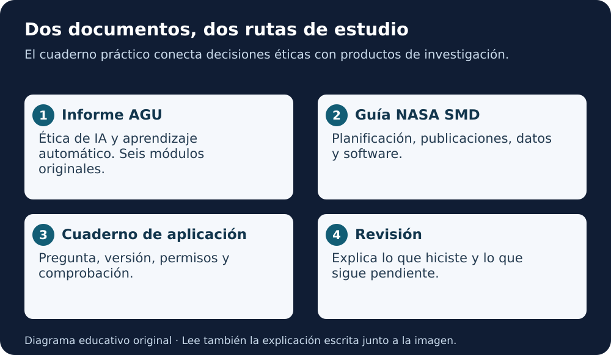

# Biblioteca de estudio · Documentos en español

[Inicio](../README.md) · [Lección 5](../cursos/open-science-essentials/lecciones/05-herramientas-ciencia-abierta.md)

Estas rutas complementan los cursos. No son módulos oficiales adicionales de Canvas ni sustituyen Open Science 101. Puedes estudiarlas por capítulos, sin descargar el repositorio.

**Equivalente escrito:** el informe AGU ayuda a revisar ética, modelos y participación; la guía NASA ayuda a organizar datos, software, publicaciones y preservación. El cuaderno de aplicación conecta ambas rutas con un ejemplo sintético.

| Ruta | Fuente completa | Desarrollo en español |
|---|---|---|
| [Ética de IA y aprendizaje automático · AGU](etica-ia-agu/README.md) | Informe de 89 páginas, versión 1 de 2023 | Nueve capítulos: fundamentos, seis módulos, aplicación y anexos |
| [Ciencia abierta · Guía NASA SMD](guia-nasa-smd/README.md) | Guía de 25 páginas, v2.2 de 2025 | Cinco capítulos: alcance, publicaciones, datos, software y taller |
| [Cuaderno de aplicación](cuaderno-aplicacion.md) | Actividad original de este repositorio | Fichas editables, ejemplo y criterios de revisión |

## Cómo usarlos

1. Escoge una ruta y abre su índice.
2. Lee un capítulo y consulta las páginas originales indicadas.
3. Resuelve la práctica antes de desplegar la explicación.
4. Conserva una pregunta y una decisión por sesión.
5. Completa una ficha del cuaderno con datos genéricos o sintéticos.

Las explicaciones son adaptaciones educativas extensas en español, con conceptos traducidos y desarrollados. No son traducciones literales completas de las 114 páginas. Se mantiene un mapa de cobertura para poder profundizar sin perder el original.

Cada capítulo distingue fuente, ejemplo añadido y actividad pendiente. Los diagramas son originales y tienen explicación escrita; hay guiones para lectura en voz alta, sin archivos de audio producidos.
