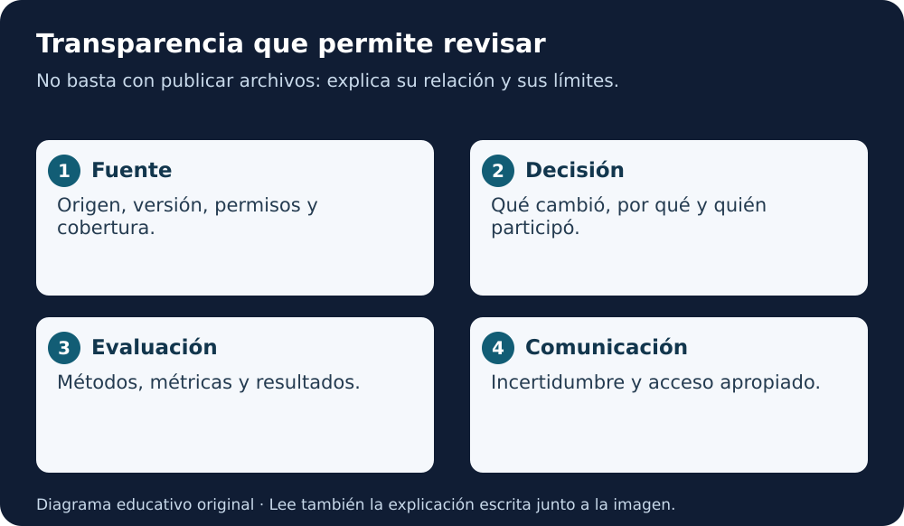

# Módulo 1 · Transparencia, documentación y comunicación

[Índice AGU](README.md) · [Lección 5](../../cursos/open-science-essentials/lecciones/05-herramientas-ciencia-abierta.md)

**Fuente:** informe AGU de 2023, páginas PDF **19–23**. La numeración impresa es una menos que la posición PDF desde la segunda página. Adaptación educativa en español; ejemplos y prácticas añadidos por este repositorio. [Autoría y licencia](README.md#fuente-y-derechos).

**Equivalente escrito:** Fuente, decisión, evaluación y comunicación forman una documentación revisable.

## Objetivo y sentido

Debes poder reconstruir las decisiones de una investigación, no solo descargar su código. El módulo 1 considera transparencia como acceso comprensible a información relevante: fuentes, transformaciones, participantes, incertidumbre, límites y motivos de las decisiones.

La documentación se produce mientras se trabaja. Si se redacta solo al final, es fácil olvidar por qué se descartaron mediciones, qué versión se utilizó o qué observación cambió el método. Un diario de decisiones conserva esa información.

## Tres tareas distintas

**Transparentar** es hacer visible lo necesario para comprender y revisar. **Documentar** es registrar el procedimiento y su contexto. **Comunicar** es presentar resultados y límites a un público concreto. Subir cientos de archivos sin explicación puede cumplir una función de almacenamiento y fallar en las otras tres.

El informe reconoce tensiones con privacidad, propiedad intelectual y soberanía de datos. Si el acceso se limita, explica qué se protege, quién puede autorizar acceso y qué alternativa permite evaluar el trabajo. No incluyas el dato sensible en la explicación de la restricción.

## Qué documentar durante el ciclo

| Etapa | Registro útil | Pregunta que permite responder |
|---|---|---|
| Diseño | Pregunta, finalidad y alternativas | ¿Por qué este método? |
| Datos | Fuente, versión, permisos y cobertura | ¿A quién o qué representan? |
| Preparación | Filtros, exclusiones y unidades | ¿Qué cambió respecto del original? |
| Modelo | Configuración, entrenamiento y dependencias | ¿Qué sistema produjo la salida? |
| Evaluación | Partición, métricas y casos difíciles | ¿Qué se probó y qué quedó fuera? |
| Comunicación | Limitaciones, autoría y versión | ¿Qué puede concluir quien lo usa? |

El informe pide reconocer a personas expertas y otros contribuyentes. La revisión de una comunidad o la curación de datos también pueden sostener un resultado. Describe aportes reales, sin asignar coautorías ficticias.

## Procedencia: un pequeño ejemplo

Caso sintético: una tabla llega en kelvin y se transforma a grados Celsius. El registro debe conservar la fuente, la unidad original, la fórmula utilizada, la versión del código y la razón del cambio. Una columna llamada “temperatura” sin unidad deja una ambigüedad aunque el archivo sea CSV.

Si se eliminan filas, registra el criterio y cuántas se excluyeron. No cambies silenciosamente los valores originales para que el gráfico quede mejor. Conserva, cuando sea apropiado, datos originales y productos derivados separados.

## Ficha de modelo

El informe presenta las model cards como una forma de ordenar información. Una ficha educativa puede contener:

- Nombre, versión, fecha y responsables reales.
- Pregunta y uso previsto; usos para los que falta evidencia.
- Datos de entrenamiento y evaluación con sus condiciones.
- Factores que afectan el rendimiento y métricas seleccionadas.
- Pruebas, incertidumbre, limitaciones y riesgos.
- Forma de comunicar correcciones y estado de mantenimiento.

La ficha no sustituye código, datos ni validación. Sirve como entrada legible a esos materiales. No llenes casillas con afirmaciones genéricas como “sin sesgos”.

## Práctica: documentar una exclusión

Imagina diez registros sintéticos; dos tienen unidad desconocida. Propón qué harías y redacta una entrada de diario: fecha, problema, alternativa considerada, decisión, efecto y revisión pendiente. No es obligatorio eliminar: tal vez puedas recuperar la unidad. Explica la razón.

**Criterios:** el lector distingue dato original y transformación; reconoce lo que falta; puede localizar la versión pertinente; no confunde propuesta con ejecución.

## Pregunta que debes llevar al equipo

¿Qué información necesitaría alguien dentro de seis meses para reconstruir esta decisión? Si la respuesta solo está en un chat privado, crea una descripción pública apropiada cuando tengas autorización.

## Para recordar

Transparencia útil significa explicar decisiones y límites con un nivel adecuado de detalle. Compartir más archivos no siempre significa comprender mejor.

Revisión de comprensión

Explica el concepto central con tus palabras, aplícalo al caso sintético y aporta una evidencia que permita revisar tu decisión. Una definición memorizada sin ejemplo todavía no demuestra transferencia.

**Para leer en voz alta:** lee el objetivo, el ejemplo y «Para recordar». El material es textual; no se ha generado audio.

[Volver al índice y elegir el capítulo siguiente](README.md)
