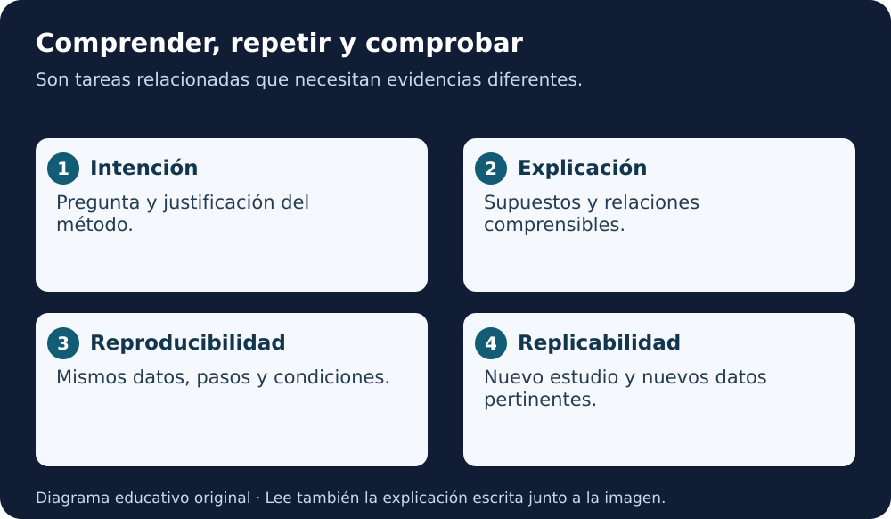

# Módulo 2 · Intención, interpretación y reproducibilidad

[Índice AGU](README.md) · [Lección 5](../../cursos/open-science-essentials/lecciones/05-herramientas-ciencia-abierta.md)

**Fuente:** informe AGU de 2023, páginas PDF **24–29**. La numeración impresa es una menos que la posición PDF desde la segunda página. Adaptación educativa en español; ejemplos y prácticas añadidos por este repositorio. [Autoría y licencia](README.md#fuente-y-derechos).

**Equivalente escrito:** La pregunta y la explicación orientan el método; repetir con los mismos datos y estudiar con datos nuevos son comprobaciones distintas.

## Cinco conceptos que no deben mezclarse

**Intencionalidad:** qué pregunta quieres responder y por qué eliges el método. **Interpretabilidad:** cómo puedes comprender relaciones internas relevantes entre entradas y salidas. **Explicabilidad:** qué razones o descripciones permiten entender el resultado a distintos públicos. Estos términos tienen usos distintos entre disciplinas; aquí seguimos la distinción educativa del informe, sin presentarla como única definición posible.

**Reproducibilidad computacional:** resultados consistentes con los mismos datos, pasos, código y condiciones. **Replicabilidad:** resultados compatibles en un nuevo estudio con nuevos datos sobre la misma pregunta, siguiendo la convención de las Academias Nacionales empleada en el glosario del informe.

Un gráfico que “se parece” al anterior no demuestra las cinco cosas. Tampoco una explicación generada después prueba que el modelo usó realmente esa razón.

## Empieza por la pregunta

Escribe qué fenómeno estudias, la unidad de análisis, el resultado que quieres estimar y las alternativas. La elección de una técnica compleja requiere justificación frente a opciones más simples.

Caso didáctico: quieres estimar una temperatura a partir de mediciones próximas. Compara primero una referencia sencilla, como una media apropiada o persistencia temporal. Si un modelo complejo mejora una métrica, comprueba si esa mejora se sostiene fuera de los datos usados para elegirlo.

La intención incluye los límites: un modelo diseñado para una cuenca no queda validado para cualquier región por compartir la misma variable de salida.

## Explica a dos niveles

Para una persona especialista, proporciona supuestos, variables, parámetros, función objetivo y evaluación. Para una persona no especialista, describe qué entra, qué sale, cuándo falla y qué decisión puede apoyar. La explicación sencilla debe conservar la incertidumbre.

**Ejemplo:** “El modelo utiliza observaciones previas para estimar el siguiente valor; funciona peor donde faltan mediciones”. Esa explicación orienta mejor que “la IA conoce el clima”. Para verificarla hacen falta datos y pruebas, no solo buena redacción.

## Diseña una comprobación reproducible

Conserva la versión de datos y código, dependencias relevantes, configuración y pasos de ejecución. Cuando existe aleatoriedad, registra semillas y estudia la variación entre ejecuciones. Una semilla puede ayudar, pero no garantiza identidad numérica entre plataformas o implementaciones.

Prepara un pequeño conjunto de verificación con salida esperada y tolerancia justificada. Si solo publicas el modelo final y no el procedimiento, otra persona quizá pueda ejecutar inferencia, pero no reconstruir el entrenamiento.

El informe recomienda probar robustez e informar incertidumbre. Define de antemano qué cambio considerarías aceptable y qué discrepancia debe investigarse. No uses la palabra “robusto” por haber completado una sola ejecución.

## Conocimiento del dominio

El caso Cassini del informe ilustra por qué los datos de una nave requieren contexto físico. Una buena clasificación numérica puede no responder a la pregunta sobre el entorno planetario. La órbita, cobertura y condiciones de adquisición pueden influir en lo que observa el modelo.

Aquí se estudia ese razonamiento; no se descargaron datos de Cassini, no se reprodujo el artículo citado ni se validó un modelo espacial. Las cifras históricas del ejemplo no se utilizan como prueba del rendimiento de herramientas actuales.

## Exploración y registro previo

Una investigación exploratoria puede empezar sin una hipótesis cerrada. Aun así, registra su intención y las decisiones. Si después formulas una hipótesis a partir de los datos, indícala como resultado exploratorio y busca una comprobación apropiada. No reconstruyas un plan previo ficticio.

## Práctica

Diseña una comprobación para el ejemplo sintético de la lección 4: identifica entradas, cálculo, salida esperada y tolerancia. Después explica qué necesitarías para repetirlo con datos de otra fuente.

**Criterio:** distingues repetir el cálculo de comprobar una conclusión con nuevas observaciones. Señalas qué materiales faltan para cada tarea.

## Para recordar

Comprender una salida, repetir un cálculo y confirmar una conclusión son actividades relacionadas, pero distintas. Documenta cuál realizaste.

Revisión de comprensión

Explica el concepto central con tus palabras, aplícalo al caso sintético y aporta una evidencia que permita revisar tu decisión. Una definición memorizada sin ejemplo todavía no demuestra transferencia.

**Para leer en voz alta:** lee el objetivo, el ejemplo y «Para recordar». El material es textual; no se ha generado audio.

[Volver al índice y elegir el capítulo siguiente](README.md)
