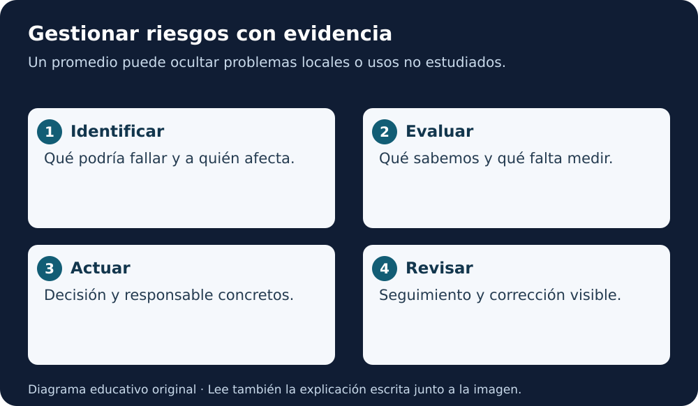

# Módulo 3 · Riesgo, sesgo y efectos

[Índice AGU](README.md) · [Lección 5](../../cursos/open-science-essentials/lecciones/05-herramientas-ciencia-abierta.md)

**Fuente:** informe AGU de 2023, páginas PDF **30–33**. La numeración impresa es una menos que la posición PDF desde la segunda página. Adaptación educativa en español; ejemplos y prácticas añadidos por este repositorio. [Autoría y licencia](README.md#fuente-y-derechos).

**Equivalente escrito:** Identifica el posible fallo, evalúa evidencia, asigna una acción y revisa sus consecuencias.

## Mira el sistema completo

El informe pide identificar riesgos desde la formulación del problema hasta los usos posteriores. No basta con buscar una columna sesgada en la tabla final. Las decisiones sobre qué medir, dónde instalar sensores, qué excluir y qué optimizar pueden producir consecuencias diferentes para distintos grupos o lugares.

Un sesgo estadístico y un trato injusto no son términos intercambiables. Debes explicar qué significa “sesgo” en cada evaluación y quién podría sufrir sus efectos. Un promedio aceptable puede ocultar errores concentrados en una zona.

## Fuentes de riesgo

**Datos:** cobertura insuficiente, mediciones erróneas, etiquetas poco fiables o cambios temporales. **Diseño:** objetivo que no representa la necesidad real. **Modelo:** supuestos y decisiones que agravan diferencias. **Uso:** aplicar fuera del contexto estudiado. **Comunicación:** presentar una estimación como certeza.

También pueden existir fallos accidentales o manipulación de entradas. El informe menciona la sensibilidad de modelos ambientales a perturbaciones. Para estudiar esto no necesitas atacar un sistema real: puedes analizar un ejemplo sintético y describir las pruebas autorizadas que serían necesarias.

## El caso de una red desigual

Supón una cuenca ficticia con ocho sensores en zonas accesibles y ninguno en sectores remotos. Un modelo puede funcionar bien en la evaluación disponible y desconocerse su rendimiento donde no hay mediciones. La ausencia de datos no equivale a ausencia de riesgo.

El siguiente paso no es declarar que el modelo discrimina sin análisis. Describe la brecha, quién podría verse afectado y qué evidencia ayudaría: nuevas mediciones, evaluación por regiones o una limitación explícita del uso. No conviertas una solución técnica en sustituto de la participación.

## Registro de riesgos

| Situación | Posible consecuencia | Evidencia necesaria | Acción propuesta |
|---|---|---|---|
| Falta cobertura en una zona | Estimaciones no representativas | Distribución y calidad de observaciones | Limitar alcance y revisar cobertura |
| Confusión de unidades | Resultados desplazados | Diccionario y controles de entrada | Validar antes de calcular |
| Nueva región | Rendimiento desconocido | Evaluación independiente pertinente | No afirmar generalización |
| Resultado comunicado sin límite | Decisiones basadas en certeza aparente | Prueba de comprensión del mensaje | Incluir alcance e incertidumbre |

La tabla es una propuesta educativa, no una evaluación real. Añade responsable, fecha de revisión y estado. Una lista sin decisiones ni seguimiento no gestiona el riesgo.

## Responsabilidad compartida y concreta

La responsabilidad puede repartirse entre desarrollo, curación, uso y financiación. Eso no significa que desaparezca: cada tarea necesita una persona o rol identificable. El informe propone contactos válidos y una respuesta cuando se detecta un daño.

Distingue autorizar la publicación, mantener el sistema y recibir avisos. Una persona puede asumir varios roles en un equipo pequeño, pero debe quedar claro qué puede decidir y cuándo requiere apoyo.

## Si aparece un problema después de publicar

La respuesta depende del alcance: registrar el aviso, confirmar la versión afectada, evaluar consecuencias, comunicar límites o correcciones y tratar la causa. Si corresponde, retirar o desaconsejar una versión no validada para su uso. Conserva un aviso visible y la relación con la corrección, siguiendo la política del archivo.

Una corrección silenciosa puede dejar circulando copias problemáticas. El informe subraya que la responsabilidad no desaparece solo porque terminó la financiación; las instituciones también deben planificar recursos para responder.

## Práctica

Completa dos filas nuevas del registro para un ejemplo genérico. Una debe ser un problema técnico y otra un problema de interpretación o participación. Explica cómo detectarías cada una y quién revisaría la respuesta.

**Criterios:** riesgo específico, persona o sistema afectado, evidencia observable y acción proporcional. Evita frases imposibles de verificar como “eliminar todos los sesgos”.

## Para recordar

El riesgo se gestiona con decisiones, evidencia y seguimiento. Publicar una advertencia no sustituye corregir un problema que ya identificaste.

Revisión de comprensión

Explica el concepto central con tus palabras, aplícalo al caso sintético y aporta una evidencia que permita revisar tu decisión. Una definición memorizada sin ejemplo todavía no demuestra transferencia.

**Para leer en voz alta:** lee el objetivo, el ejemplo y «Para recordar». El material es textual; no se ha generado audio.

[Volver al índice y elegir el capítulo siguiente](README.md)
