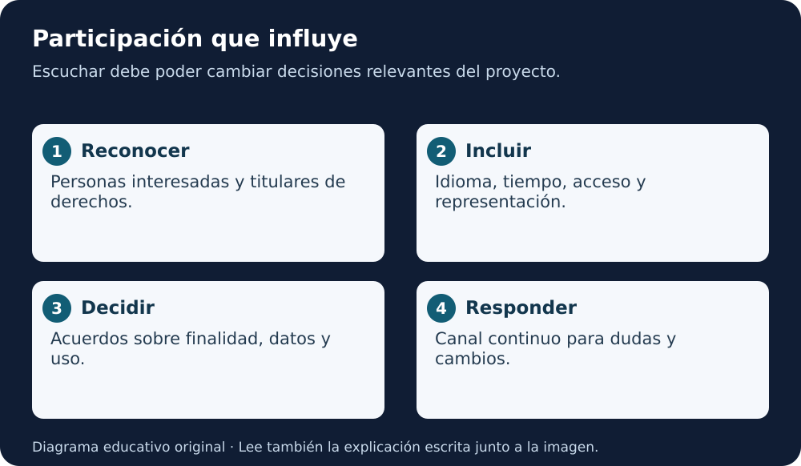

# Módulo 4 · Participación y gobernanza de datos

[Índice AGU](README.md) · [Lección 5](../../cursos/open-science-essentials/lecciones/05-herramientas-ciencia-abierta.md)

**Fuente:** informe AGU de 2023, páginas PDF **34–38**. Adaptación educativa en español, con ejemplos y ejercicios originales añadidos. La página impresa es una menos que la posición PDF desde la segunda página. [Autoría y licencia](README.md#fuente-y-derechos).

**Equivalente escrito:** Reconoce voces y derechos, elimina barreras, acuerda decisiones y mantén una respuesta continua.

## Participar debe poder cambiar decisiones

El módulo 4 pide incorporar a las personas y comunidades relacionadas con una investigación desde su concepción y durante sus etapas posteriores. Una reunión informativa al final no equivale a participación en el diseño.

La pregunta práctica es: **¿qué decisión puede cambiar gracias a esa participación?** Si el propósito, los datos y el uso ya se decidieron sin posibilidad de revisión, quizá solo estás comunicando un resultado. La comunicación sigue siendo útil, pero debe nombrarse correctamente.

## Personas interesadas y titulares de derechos

El informe distingue personas u organizaciones interesadas de quienes tienen derechos sobre territorio, conocimientos o datos. No son categorías equivalentes. Tener una tabla accesible no concede automáticamente autoridad para utilizar conocimientos de una comunidad en cualquier propósito.

El enfoque de consentimiento continuo del informe es un principio de participación; su aplicación requiere contexto, acuerdos y revisión institucional cuando corresponda. No se presenta aquí como una regla jurídica universal para toda investigación.

## FAIR y CARE responden preguntas diferentes

**FAIR** orienta la encontrabilidad, el acceso, la interoperabilidad y la reutilización. **CARE** incorpora beneficio colectivo, autoridad para controlar, responsabilidad y ética en relación con datos indígenas.

Un producto puede estar muy bien descrito y seguir teniendo un uso inapropiado. Por eso, además de preguntar “¿puedo descargarlo?”, pregunta “¿quién autoriza su uso, para qué finalidad y con qué beneficio?”. No reduzcas CARE a una casilla que un equipo externo marca por su cuenta.

El informe menciona también OCAP en su discusión de principios de datos. Su contexto específico importa: no es un sustituto genérico de toda gobernanza de datos. Las referencias del original permiten profundizar sin atribuir acuerdos inexistentes a ninguna comunidad.

## Diseña la participación

Empieza por identificar quién utiliza el resultado, quién puede verse afectado, quién aporta conocimiento y quién decide sobre los datos. Pregunta quién falta. Considera idioma, conectividad, horarios, discapacidad y recursos.

Después define cómo se recogerán propuestas, cómo se responderán y quién puede revisar una decisión. Reserva tiempo y presupuesto. Una persona invitada no representa por sí sola a una población completa.

| Momento | Conversación útil | Evidencia de participación |
|---|---|---|
| Pregunta | ¿Este problema es relevante? | Cambio o confirmación razonada del propósito |
| Datos | ¿Qué información es sensible? | Acuerdo sobre acceso y finalidad |
| Diseño | ¿Qué errores preocupan más? | Criterios de evaluación pertinentes |
| Comunicación | ¿Se entiende el resultado? | Correcciones al mensaje |
| Después | ¿Hay usos o daños nuevos? | Canal de revisión y respuesta |

## Caso didáctico: mapa ambiental

Un equipo ficticio quiere publicar ubicaciones precisas de puntos de agua. La precisión puede ayudar a estudiar el entorno y también revelar lugares que la comunidad considera sensibles. La decisión no se resuelve únicamente retirando nombres de personas.

El equipo debería consultar finalidad, permisos y alternativas: niveles de agregación, acceso controlado o metadatos limitados, según el caso. Cada alternativa puede perder utilidad o conservar riesgos. Documenta ese equilibrio y quién participa en la decisión.

## Práctica

Dibuja un mapa de cuatro roles para el caso: quienes producen datos, quienes tienen derechos, quienes utilizarían el resultado y quienes podrían resultar afectados. Una persona puede ocupar más de un rol. Identifica una barrera de participación y una decisión que sí admitiría cambios.

**Criterio:** distingues consulta de decisión compartida, no inventas consentimiento y no publicas información real de una comunidad.

## Para recordar

Participación requiere voz, capacidad de influir y continuidad. La apertura técnica de un archivo no resuelve por sí sola los derechos de quienes aparecen o están representados en él.

Revisión de comprensión

Identifica una decisión, quién participa y qué evidencia permite revisarla. Explica un límite del capítulo. Distingue una recomendación del informe de una obligación real o de una actividad ya ejecutada.

**Lectura en voz alta:** usa «Para recordar» como cierre y explica un ejemplo sin leer. Solo hay guion textual; no hay MP3.

[Volver al índice y elegir el capítulo siguiente](README.md)
