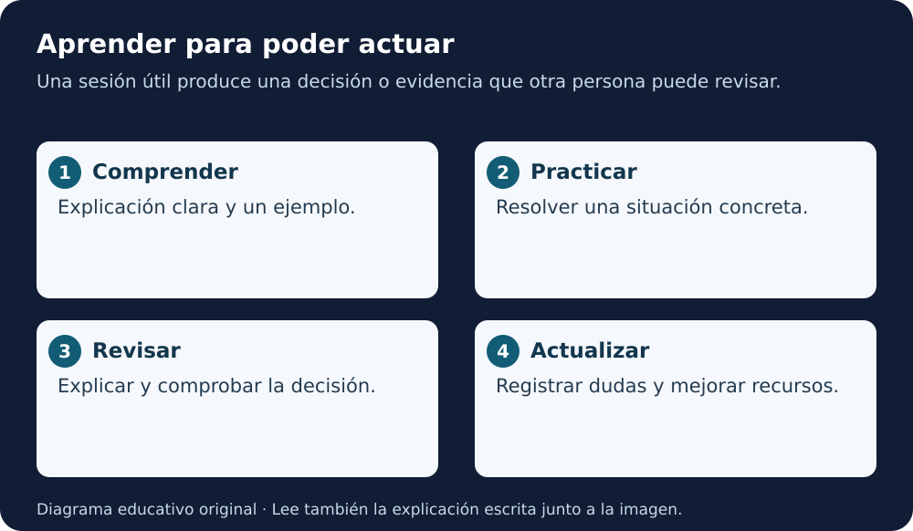

# Módulo 5 · Formación, divulgación y prácticas

[Índice AGU](README.md) · [Lección 5](../../cursos/open-science-essentials/lecciones/05-herramientas-ciencia-abierta.md)

**Fuente:** informe AGU de 2023, páginas PDF **39–42**. Adaptación educativa en español, con ejemplos y ejercicios originales añadidos. La página impresa es una menos que la posición PDF desde la segunda página. [Autoría y licencia](README.md#fuente-y-derechos).

**Equivalente escrito:** Comprender, practicar y revisar producen mejoras que deben mantenerse actualizadas.

## Aprender ética es aprender a actuar

El informe distingue conocer principios de poder aplicarlos. Saber que un modelo puede tener sesgos no basta si no sabes identificar un caso, pedir ayuda o modificar el procedimiento. La formación necesita ejercicios, recursos accesibles y tiempo reconocido.

No existe un mismo punto de entrada para estudiantes, personal técnico, responsables institucionales y personas usuarias. La estructura modular permite aprender según la tarea: entender un resultado, revisar datos, autorizar una publicación o gestionar una incidencia.

## Un plan de aprendizaje por niveles

**Nivel inicial:** reconocer qué hace una herramienta, sus entradas, salidas y límites. **Nivel de práctica:** documentar, evaluar y explicar decisiones. **Nivel de coordinación:** establecer responsabilidades y recursos para que otras personas puedan hacerlo.

Los niveles no son títulos ni certificaciones. Una persona experta en un dominio puede necesitar una introducción a datos; alguien experto en programación puede necesitar apoyo en participación comunitaria.

## Diseñar para la alfabetización digital

Este repositorio aplica una recomendación del informe: adaptar la formación al público. Para quien empieza, muestra una acción por vez, explica palabras nuevas y acompaña iconos con texto. Proporciona una alternativa escrita a cada diagrama.

Una captura de pantalla puede quedar desactualizada; una explicación de la finalidad sigue siendo útil. Evita instrucciones que dependan de adivinar un botón o de distinguir solo colores. En GitHub, las respuestas desplegables funcionan como práctica de lectura, pero no registran una nota.

## Antes y después de trabajar

El informe propone anticipar problemas mediante un **premortem**: imaginar que el proyecto falló y discutir las causas posibles. No es pesimismo; permite descubrir supuestos antes de gastar recursos.

Después, una revisión de lo ocurrido compara expectativas y resultados. Pregunta qué funcionó, qué falló, qué se aprendió y qué cambiaría. No uses esa revisión para buscar culpables sin comprender el proceso.

Ejemplo didáctico: antes de un ejercicio de datos, alguien advierte que las unidades podrían confundirse. El equipo añade un diccionario. Al terminar, verifica si una persona nueva pudo interpretar la tabla sin ayuda.

## Formato de una sesión de 30 minutos

1. Cinco minutos para explicar una decisión realista.
2. Diez minutos para leer un caso sintético y localizar lo que falta.
3. Diez minutos para proponer y comparar respuestas.
4. Cinco minutos para registrar una mejora y una duda.

El tiempo es una propuesta didáctica, no una duración oficial del informe. Una sesión exitosa produce una evidencia revisable: una ficha, un criterio o una corrección. La asistencia por sí sola no demuestra aprendizaje.

## Comunidades y actualización

Una comunidad puede compartir ejemplos, detectar cambios en herramientas y acompañar a personas nuevas. Necesita normas de participación y reconocimiento de quienes enseñan, mantienen y revisan.

Revisa periódicamente los recursos: versiones, enlaces, políticas y ejemplos. Un material antiguo puede enseñar un concepto valioso y contener una instrucción operativa obsoleta. Fecha las revisiones y diferencia las correcciones de una nueva interpretación.

## Práctica

Escoge un concepto del capítulo anterior. Escribe una explicación de cien palabras para alguien que comienza y una actividad de cinco minutos. Añade una pregunta que permita comprobar comprensión y una alternativa accesible al recurso visual.

**Criterio:** la actividad exige decidir o explicar, no copiar una definición. Comprueba el resultado con una persona real cuando sea posible; registra esa revisión solo después de realizarla.

## Para recordar

La formación se evalúa por las decisiones que permite tomar. Enseñar con claridad y mantener recursos también son contribuciones científicas.

Revisión de comprensión

Identifica una decisión, quién participa y qué evidencia permite revisarla. Explica un límite del capítulo. Distingue una recomendación del informe de una obligación real o de una actividad ya ejecutada.

**Lectura en voz alta:** usa «Para recordar» como cierre y explica un ejemplo sin leer. Solo hay guion textual; no hay MP3.

[Volver al índice y elegir el capítulo siguiente](README.md)
