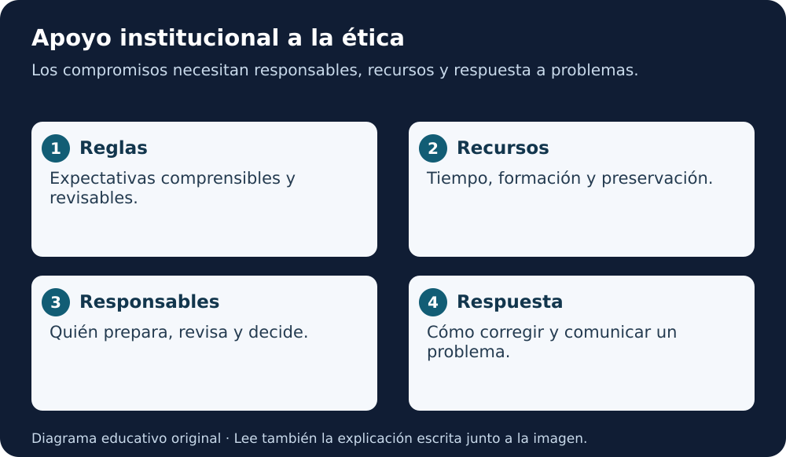

# Módulo 6 · Instituciones, editoriales y financiadores

[Índice AGU](README.md) · [Lección 5](../../cursos/open-science-essentials/lecciones/05-herramientas-ciencia-abierta.md)

**Fuente:** informe AGU de 2023, páginas PDF **43–48**. Adaptación educativa en español, con ejemplos y ejercicios originales añadidos. La página impresa es una menos que la posición PDF desde la segunda página. [Autoría y licencia](README.md#fuente-y-derechos).

**Equivalente escrito:** Las reglas necesitan recursos y responsables; la respuesta a problemas permite revisar los compromisos.

## La ética necesita una organización que la sostenga

El módulo 6 explica por qué las buenas intenciones individuales no bastan. Hacen falta políticas comprensibles, formación, mecanismos para resolver conflictos y recursos para responder cuando un sistema falla.

Las organizaciones deben nombrar tensiones: apertura y privacidad; rapidez y revisión; propiedad intelectual y reutilización; demostración y uso a escala. Ocultarlas no las resuelve. Cada contexto requiere decisiones justificadas.

## Quién hace qué

| Actor | Responsabilidad destacada por el informe | Evidencia propuesta |
|---|---|---|
| Institución | Definir procesos y apoyo para investigación responsable | Política, responsables y canal de consulta |
| Sociedad científica | Mantener guías, diálogo y formación | Actualizaciones y participación |
| Financiador | Incluir expectativas y recursos apropiados | Convocatoria y presupuesto coherentes |
| Editorial | Orientar autoría, revisión, datos e incertidumbre | Instrucciones y aplicación consistente |
| Equipo | Explicar procedimientos y comunicar problemas | Registros y correcciones identificables |

La evidencia de la última columna es una aplicación educativa. El informe no impone esta tabla a todas las instituciones.

## Recursos e incentivos

Documentar, incluir comunidades, evaluar sesgos y conservar software cuestan tiempo. Si solo se recompensa un resultado novedoso, esas tareas pueden quedar invisibles. El informe pide reconocerlas y financiarlas.

Los resultados negativos y las replicaciones también aportan conocimiento. Una editorial que solo destaca éxitos puede favorecer una imagen distorsionada del rendimiento. Un equipo que registra fallos facilita que otros eviten repetirlos.

La financiación de formación o intervención no asegura calidad, pero hace viable el trabajo que se exige. Define qué gasto sostiene cada compromiso y qué ocurrirá al terminar el proyecto.

## Gobernanza antes del conflicto

Diseña un procedimiento para recibir dudas y avisos. Debe indicar quién los registra, quién evalúa consecuencias, quién puede autorizar una corrección y cómo se informa a las personas afectadas.

En un equipo pequeño puede bastar un esquema sencillo con roles claros. Una organización grande necesitará coordinación adicional. El informe presenta funciones de liderazgo y consulta; no exige que cada grupo cree una oficina ni un puesto nuevo.

Una política debe poder revisarse. Establece cuándo evaluar su funcionamiento, quién participa y cómo se documentan los cambios. No declares éxito solo porque existe un documento.

## Prototipo y uso real

El informe pide reconocer la diferencia entre beta y despliegue a escala, y entre situaciones ordinarias y emergencias. Una demostración con datos sintéticos no respalda una aplicación que afecte decisiones reales.

Caso didáctico: un laboratorio comparte un clasificador de ejemplo. Una organización externa quiere usarlo para asignar recursos. Antes de presentar esa transferencia como aprobada, hacen falta evaluación pertinente, responsables, permisos y límites claros. La licencia del código no certifica aptitud para esa tarea.

## Seguimiento e intervención

Las instituciones deben poder enterarse de daños y actuar de manera proporcionada. Eso incluye corregir información, revisar usos, consultar a quienes resulten afectados y mantener trazabilidad de las decisiones.

El informe defiende una mejora oportuna e iterativa. Eso no significa publicar cualquier cosa rápidamente: significa disponer de un proceso revisable que evite tanto la parálisis como la difusión irresponsable.

## Práctica

Diseña una pequeña política para un grupo educativo ficticio: finalidad, materiales compartibles, revisión, canal de avisos y mantenimiento. Asigna roles, no nombres de personas sin su autorización. Incluye un ejemplo de resultado negativo que debería conservarse.

**Criterios:** cada compromiso tiene un responsable y recursos; existe una forma de revisar decisiones; no se atribuyen certificaciones o cumplimiento normativo no demostrados.

## Para recordar

Una institución ayuda a practicar ética cuando transforma principios en tiempo, apoyo, decisiones y respuestas verificables.

Revisión de comprensión

Identifica una decisión, quién participa y qué evidencia permite revisarla. Explica un límite del capítulo. Distingue una recomendación del informe de una obligación real o de una actividad ya ejecutada.

**Lectura en voz alta:** usa «Para recordar» como cierre y explica un ejemplo sin leer. Solo hay guion textual; no hay MP3.

[Volver al índice y elegir el capítulo siguiente](README.md)
