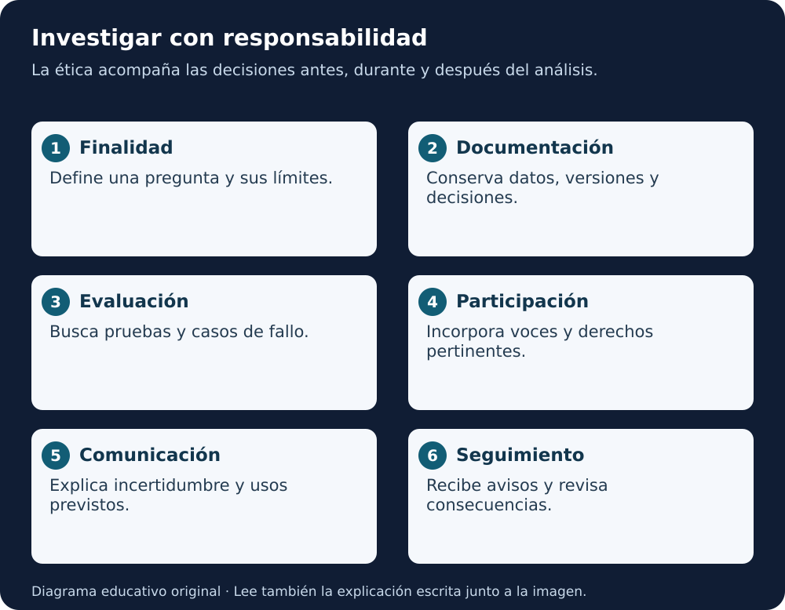

# Ética de IA/ML en ciencias de la Tierra, el espacio y el ambiente

[Biblioteca](../README.md) · [Lección 5](../../cursos/open-science-essentials/lecciones/05-herramientas-ciencia-abierta.md) · [Cuaderno práctico](../cuaderno-aplicacion.md)

**Ruta de estudio en español del informe AGU de 89 páginas.** Lee por capítulos; conserva el original para consultar matices, referencias y figuras. Los ejemplos de esta ruta son genéricos o sintéticos.

**Equivalente escrito:** define la pregunta, registra decisiones, comprueba el método, incorpora a quienes corresponde y comunica resultados con límites. Después de compartir, conserva la capacidad de recibir y corregir problemas. La ética acompaña todo el ciclo.

## Qué contiene y por dónde empezar

Los seis módulos del informe se conservan como seis capítulos con nombre y desarrollo propios. Se añaden fundamentos, aplicación y lectura crítica de los anexos. No se reduce el informe a una lista de recomendaciones.

| Orden | Capítulo en español | Páginas PDF | Resultado de estudio |
|---|---|---|---|
| 1 | [Fundamentos, conducta y confianza](01-fundamentos-y-confianza.md) | 2–18 | Distinguir confianza y evidencia |
| 2 | [Módulo 1 · Transparencia y documentación](02-transparencia-y-documentacion.md) | 19–23 | Crear un registro de decisiones |
| 3 | [Módulo 2 · Intención, explicación y reproducción](03-intencion-explicacion-y-reproduccion.md) | 24–29 | Diseñar una comprobación |
| 4 | [Módulo 3 · Riesgo, sesgo y efectos](04-riesgo-sesgo-y-efectos.md) | 30–33 | Preparar un registro de riesgos |
| 5 | [Módulo 4 · Participación](05-participacion-y-gobernanza-datos.md) | 34–38 | Identificar voces y derechos |
| 6 | [Módulo 5 · Formación y comunidad](06-formacion-y-comunidad.md) | 39–42 | Diseñar una actividad accesible |
| 7 | [Módulo 6 · Instituciones](07-responsabilidades-institucionales.md) | 43–48 | Asignar apoyo y responsabilidades |
| 8 | [Aplicación y glosario](08-aplicacion-y-glosario.md) | 49–55 | Revisar un expediente sintético |
| 9 | [Anexos y lectura crítica](09-anexos-y-lectura-critica.md) | 56–89 | Interpretar encuestas y marcos históricos |

**Numeración:** la primera página del archivo es la ficha de ESS Open Archive con autores, DOI y licencia. A partir de la segunda página, la posición del visor PDF es una más que la numeración impresa del informe. Por ejemplo, PDF 19 corresponde a página impresa 18.

La cobertura incluye visión e introducción, códigos de conducta, confianza, los seis módulos, implementación, glosario, bibliografía y apéndices A–D. Las listas bibliográficas y de participantes se explican por su función; no se traducen ni reproducen línea por línea.

## Forma de estudiar

Puedes seguir una sesión por capítulo: leer, revisar el original y completar la actividad. El tiempo depende de tu experiencia. Para una consulta puntual, busca “datos”, “riesgo”, “participación” o “institución” en el índice.

No necesitas entrenar modelos ni crear cuentas. Si empiezas con herramientas digitales, lee primero el ejemplo y «Para recordar». Los desplegables ofrecen una pauta de revisión; no guardan una calificación.

## Fuente y derechos

**Stall, S. y colaboradores; AGU AI/ML Ethics Workshop Participants (2023). _Ethical and Responsible Use of AI/ML in the Earth, Space, and Environmental Sciences: Modules for Understanding and Capability_. Informe comunitario facilitado por American Geophysical Union.**

- [PDF íntegro de 89 páginas](../../assets/docs/AGU-Etica-IA-ML-2023-v1.pdf), sin modificaciones.
- [DOI de esta versión](https://doi.org/10.22541/essoar.168132856.66485758/v1).
- Fecha del informe: 11 de abril de 2023; la ficha muestra publicación el 12 de abril y fecha de cubierta del depósito el 13. Se conserva la versión **v1** indicada, sin concluir que sea la versión más reciente.
- La ficha del PDF declara **preprint no revisado por pares** y **CC BY 4.0**. No se presenta como una norma oficial de NASA.
- Financiación NASA reconocida en el original: grant 80NSSC22K0734. La financiación no convierte estos apuntes en una publicación de esa agencia.
- [Condiciones CC BY 4.0 en español](https://creativecommons.org/licenses/by/4.0/deed.es): atribución, enlace e indicación de cambios, sin implicar respaldo.
- Cambios de esta adaptación: español claro, reorganización didáctica, explicaciones, ejemplos sintéticos, ejercicios, tablas y diagramas originales. Se conservan atribución y enlace al documento fuente. La adaptación se comparte bajo CC BY 4.0.
- Los materiales de terceros incluidos en el original conservan sus avisos. No se extraen sus figuras para presentarlas como imágenes propias.

## Límites de la lectura

Se extrajo texto de todas las páginas. Las figuras de encuesta en PDF 71–72 y el esquema de PDF 80 se inspeccionaron visualmente. No se ha realizado una auditoría gráfica completa de las 89 páginas ni se han reproducido los experimentos citados.

Los marcos jurídicos del apéndice C se estudian como recopilación de 2023; su vigencia y aplicabilidad no se presuponen. Las referencias generadas por ChatGPT en el apéndice D no se usan como bibliografía verificada.

**Lectura en voz alta:** “La investigación responsable empieza por una pregunta, conserva decisiones y comprueba resultados. También necesita participación, recursos y una respuesta cuando algo falla.” Guion textual, sin audio generado.

[Empezar por fundamentos →](01-fundamentos-y-confianza.md)
