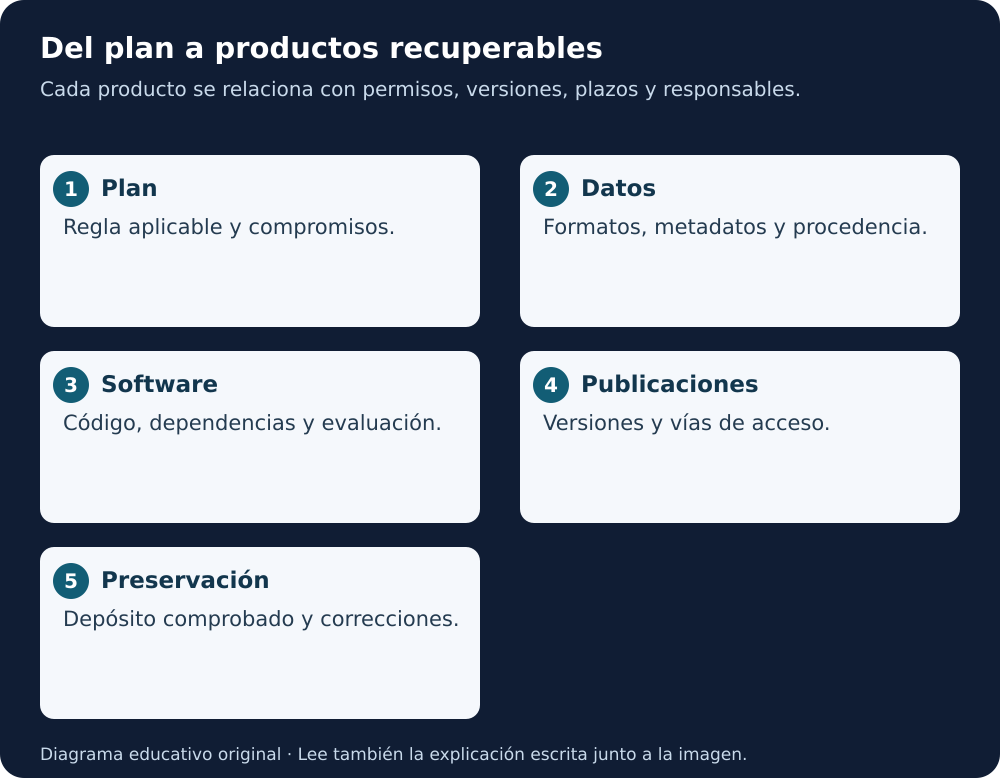

# Guía NASA SMD de ciencia abierta · Estudio en español

[Biblioteca](../README.md) · [Lección 3](../../cursos/open-science-essentials/lecciones/03-planificacion-ciencia-abierta.md) · [Lección 5](../../cursos/open-science-essentials/lecciones/05-herramientas-ciencia-abierta.md)

**Desarrollo educativo de Open-Source Science Guidance v2.2, 5 de febrero de 2025.** Cinco capítulos para estudiar las 25 páginas y preparar decisiones concretas. Traducción de conceptos y explicación propia; no es traducción oficial ni literal completa.

**Equivalente escrito:** el plan relaciona datos, software y publicaciones con sus responsables, permisos, destinos y plazos. La revisión comprueba que la entrega exista, pueda entenderse y conserve su versión. Las restricciones se justifican según las reglas pertinentes.

## Capítulos y cobertura

| Capítulo | Páginas PDF | Para qué sirve |
|---|---|---|
| [1 · Alcance y planificación](01-alcance-y-planificacion.md) | 1–7 | Distinguir guía, política, convocatoria y OSDMP |
| [2 · Publicaciones y preprints](02-publicaciones-y-preprints.md) | 8–9 | Identificar versiones y vías de acceso |
| [3 · Datos y preservación](03-datos-metadatos-y-preservacion.md) | 10–13 | Planificar metadatos, archivo y plazos |
| [4 · Software y licencias](04-software-versiones-y-licencias.md) | 14–18 | Conservar código, permisos y entregas |
| [5 · Identificadores, eventos y taller](05-identificadores-eventos-y-taller.md) | 19–25 | Aplicar glosario y plantilla OSDMP |

La distribución cubre también portada e historial de versiones, políticas por división, glosario del apéndice A y plantilla del apéndice B. Se explica su contenido relevante y se remite al original para el texto exacto.

## Documento y contexto

- **Autor institucional:** NASA Science Mission Directorate.
- **Edición estudiada:** v2.2, 05-02-2025, 25 páginas.
- [PDF completo conservado](../../assets/docs/SMD-Open-Source-Science-Guidance-v2.2-20250205.pdf).
- [Procedencia, integridad y derechos](../../assets/docs/README.md).
- [Página oficial de política de información científica](https://science.nasa.gov/researchers/science-information-policy/), consultada el 02-11-2026.
- La guía declara que **no establece por sí sola requisitos de política**. Comprueba SPD-41a, división, convocatoria y acuerdo aplicables antes de tomar una decisión real.
- Esta ruta no declara cumplimiento, elegibilidad ni revisión de una propuesta por NASA.

## Cómo trabajar

Lee un capítulo y completa su práctica con un ejemplo sintético. Después utiliza el [mini-OSDMP](../../cursos/open-science-essentials/anexos/03-mini-osdmp.md) o el [cuaderno de aplicación](../cuaderno-aplicacion.md). Conserva una lista breve de decisiones pendientes.

Las prácticas son añadidos educativos. No se ha depositado un producto en STI, registrado una innovación, creado ORCID ni conectado Zenodo. Las obligaciones descritas pertenecen al contexto de la fuente, no a cualquier estudiante o repositorio.

**Lectura en voz alta:** “Antes de compartir, identifica el producto y la regla aplicable. Decide quién lo prepara, cuándo se entrega y dónde se conserva. Comprueba el resultado del depósito y mantén sus permisos y versiones.” Solo guion textual.

[Empezar por alcance y planificación →](01-alcance-y-planificacion.md)
